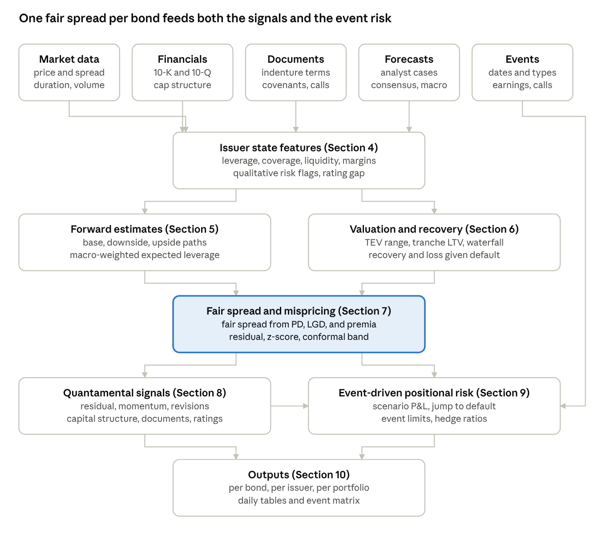
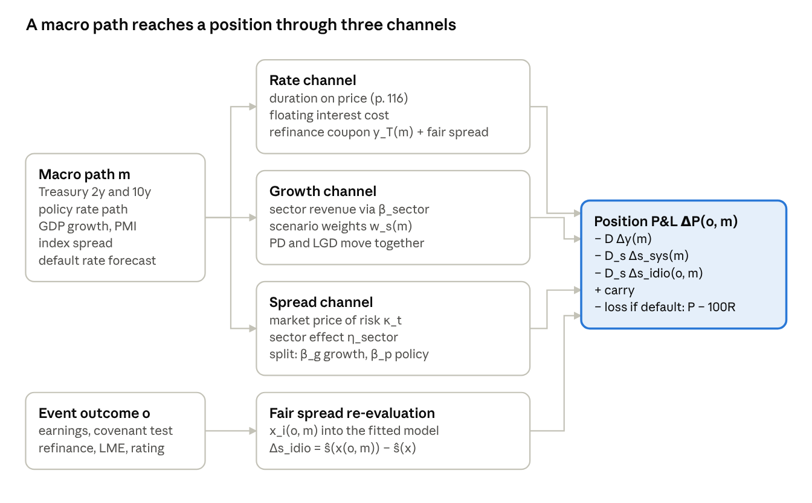

# High Yield Bond Mispricing Methodology

As of 2026-10-20. Source document: https://claude.ai/artifact/Bc984WSgCVWMiKccaCYeXa

## The book in one page

Gatto's *Credit Investor's Handbook* (Wiley, 2023) teaches one process: analyse a leveraged company in seven steps, then judge each loan or bond by its risk-adjusted return against every other investment you could make. The book has three parts. Part One gives the building blocks: the leveraged credit markets (Chapter 1, p. 62), credit cycles (Chapter 2, p. 79), trading terms (Chapter 3, p. 103), and leveraged buyouts (Chapter 4, p. 123). Part Two gives the seven-step process (Chapters 5 to 13, pp. 141–414). Part Three covers distressed debt: bankruptcy, creditor fights, subordination, liability management, and eight distressed strategies (Chapters 14 to 19, pp. 415–572).

### The seven-step process

| Step | What the analyst does | Key output | Chapter and pages |
| --- | --- | --- | --- |
| 1. Sources and uses | Ask why the company needs capital and what instruments fund it. Originations only. | Sources and uses table | 5, pp. 142–154 |
| 2. Qualitative analysis | Score eight industry and business risks, the strategy, the management team, and ESG | Risk list with mitigants | 6, pp. 155–186 |
| 3a. Profitability | Remove nonrecurring items, test earnings quality, compare with peers, judge against expectations | Adjusted income statement; red flags | 7, pp. 187–223 |
| 3b. Cash flow and liquidity | Static liquidity, maturity schedule, free cash flow, cash cycle, refinance access, levers | Liquidity runway and maturity wall | 8, pp. 224–254 |
| 3c. Capital structure | Build the capital structure table; leverage, loan-to-value, and coverage through each tranche, at face and at market; add leases, pensions, and guarantees | Priority-ordered table with ratios and ratings | 9, pp. 255–282 |
| 4. Forecasting | Set drivers, build management, base, and downside cases, assign probabilities | Scenario paths of EBITDA, leverage, liquidity | 10, pp. 283–318 |
| 5. Valuation | Comparable companies, precedent deals, DCF, liquidation; read loan-to-value off the range | Enterprise value range | 11, pp. 319–336 |
| 6. Structure and documents | Economics, collateral, maintenance and incurrence covenants, add-backs, baskets, sacred rights | Document risk list | 12, pp. 337–365 |
| 7. Recommendation | Thesis, risks and mitigants, relative value against rating indices, peers, and the issuer's own capital structure; force rank against the portfolio | Credit committee memo | 13, pp. 366–414 |

### The principles the process rests on

- Risk is the probability of default times the loss given default. Relative value compares expected return per unit of that risk, not absolute yield (p. 119).
- A bond price moves for three reasons: the risk-free rate, the market spread level, and the issuer's own risk (p. 113). Price, yield, and spread are three ways to quote one level (p. 117).
- Debt is analysed by priority. Senior claims enter at face; the tranche under analysis enters at market, which gives the creation multiple (p. 264).
- The base case is a coin toss up or down. The downside case is where credit work earns its keep (p. 285).
- Covenants give the lender a seat at the table; permissive EBITDA add-backs take it away (pp. 354–355).
- Ratings lag prices (p. 274). Forced sellers after a downgrade create the entry for a patient buyer (p. 418).
- Documents can move claims ahead of yours after you buy: drop-downs and uptiers (Chapter 18, pp. 498–513).

### The case threads

MGEC Corp carries the ratio examples. TM Corp carries the forecast. JCPenney in 2012 closes each chapter of Part Two. Valves Controls Company is the private loan memo and HCA's 2006 buyout bond is the public bond memo, with a postmortem that shows the bond returned 10% a year against 8.9% for the index with a shallower trough (p. 414).

The book gives judgement and procedure, not statistical models. It has no option-adjusted spread, no bond-CDS basis, and no liquidity model. The sections below keep the book's process as the feature set and add the models, the forward estimates, and the event risk around it.

## 1. Purpose and scope

The method ranks high yield bonds by the gap between the market spread and a fair spread. The fair spread comes from issuer fundamentals, forward estimates, and macro forecasts. The gap is the mispricing. Gatto's *Credit Investor's Handbook* gives the fundamental process. This document turns that process into inputs, transformations, and outputs that a system can compute each day.

The book states that a bond price moves for three reasons: the risk-free rate, the market spread level, and the issuer's own risk (p. 113). The method hedges the first two and trades the third.

```latex
\Delta y_i = \Delta r_f + \Delta s_{mkt} + \Delta s_{idio,i}
```

The fair spread model estimates what the issuer component should be, given the fundamentals. The signal is the residual between the market and the model.

| Item | Specification |
| --- | --- |
| Universe | US dollar high yield corporate bonds, fixed coupon, price above 80, spread below 1,000 bp |
| Below the universe | The book says to quote distressed bonds in price, not spread (p. 122). Section 6 gives a recovery price for those bonds. |
| Consumer 1 | Quantamental signals that rank bonds and issuers (Section 8) |
| Consumer 2 | Event-driven positional risk that sizes and limits positions around dated events (Section 9) |
| Mispricing horizon | 1 to 6 months, set by the measured half-life of the residual |
| Event horizon | 1 to 5 trading days around each dated event |
| Update cycle | Market data daily; financials and forecasts each quarter and on each event |

Each later section gives the inputs, the formulas, and the outputs. Section 10 gives the field names for the output tables.

## 2. Pipeline architecture

The pipeline has one spine and two consumers. Five input feeds build the issuer state. The issuer state feeds the forward estimates and the valuation. Both feed one fair spread per bond. The fair spread feeds the signals and the event risk, and the event calendar feeds the event risk directly.



The market spread also enters Section 7 directly, as the quantity that the fair spread is compared with. The signals feed the event risk because a position exists only when a signal opens it.

| Layer | Section | Cadence | Main outputs |
| --- | --- | --- | --- |
| Inputs | 3 | Market data daily; financials and documents on each filing; forecasts and macro on each release; events as dated | Typed fields in the schemas of Section 10 |
| Issuer state | 4 | On each filing and each restatement | Ratios, flags, rating gap |
| Forward estimates | 5 | Each quarter and on each macro update | Scenario paths, macro-weighted forward features |
| Valuation and recovery | 6 | Each quarter and on each capital structure change | TEV range, tranche LTV, recovery, LGD |
| Fair spread | 7 | Daily | Fair spread, residual, conformal band |
| Signals | 8 | Daily | Signal vector per bond and per issuer |
| Event risk | 9 | Daily, and intraday on an event | Scenario P&L, jump-to-default, limits, hedge ratios |

## 3. Input layer: data model

Seven feeds supply the pipeline. Every field carries two timestamps: `as_of` (the period it describes) and `available_at` (the first moment the market could read it). The model reads only fields with `available_at` before the decision time. This rule removes look-ahead from filings, estimates, and restatements.

### 3.1 Market and instrument data (per bond, daily)

| Field | Definition or source | Note |
| --- | --- | --- |
| `price_bid`, `price_ask`, `price_mid` | Dealer quotes, clean price in the US, dirty in Europe (pp. 118–119) | Bonds quoted flat when a filing is near (p. 119); flag them |
| `trace_last`, `trace_volume`, `trace_count` | TRACE prints, daily | Liquidity inputs for exit cost |
| `bid_ask_bp` | Ask minus bid in price points and in spread | Widens in stress (p. 117) |
| `ytw`, `ytm`, `oas`, `z_spread`, `g_spread` | Yield to worst, yield to maturity, option-adjusted and Treasury spreads | The book quotes spread over the Treasury of matched tenor (p. 117) |
| `spread_duration`, `mod_duration`, `convexity`, `dv01` | Risk analytics from the pricing model | Section 9 uses spread duration |
| `coupon`, `coupon_type` | Fixed cash, PIK, or toggle (p. 125) | PIK toggle lowers cash coverage |
| `maturity`, `next_call_date`, `next_call_price`, `call_schedule` | From the indenture | Bonds: non-call for half the term, then par plus half the coupon (p. 357) |
| `amount_outstanding`, `index_weight` | Issue size and index membership | Flows at index changes |
| `rating_moodys`, `rating_sp`, `rating_fitch`, `outlook`, `watch` | Agency ratings with dates | Ratings lag prices (p. 274) |
| `cds_5y` | Single-name CDS where quoted | For the bond-CDS basis, outside the book |
| `equity_price`, `market_cap`, `equity_vol`, `short_interest` | Equity market data | TEV input (p. 321); short interest as a value flag (p. 333) |

### 3.2 Issuer financials (per issuer, each filing)

| Field | Definition or source | Note |
| --- | --- | --- |
| `revenue`, `gross_profit`, `sga`, `ebitda_reported` | Income statement, 10-K and 10-Q | Keep a full cycle of history for a cyclical issuer (p. 191) |
| `nonrecurring_items[]` | Cash and non-cash restructuring, M&A costs, asset sale gains, litigation (Figure 7.3, p. 192) | Each item with a recur flag and a cash flag |
| `ebitda_adj_analyst`, `ebitda_adj_company`, `ebitda_covenant` | Three EBITDA definitions | The covenant definition permits add-backs the analyst would reject (pp. 353–354) |
| `da`, `cash_interest`, `cash_taxes`, `capex_total`, `capex_maintenance` | Cash flow statement and notes | Maintenance capex sets the cushion (p. 266) |
| `inventory`, `receivables`, `payables`, `cogs` | Balance sheet | Cash cycle inputs (pp. 240–242) |
| `cash`, `revolver_commitment`, `revolver_drawn`, `borrowing_base`, `letters_of_credit` | Liquidity inputs (Figure 8.3, p. 229) | Borrowing base limits the ABL (p. 234) |
| `maturity_schedule[1..5]` | Debt due in each of the next five years (Figure 8.4, p. 229) | Drives refinance events |
| `operating_lease_liability`, `rent_expense`, `finance_lease_debt` | Lease note | Lease-adjusted leverage (pp. 267–268) |
| `pension_underfunded`, `guarantees`, `contingent_liabilities` | Notes to the accounts | Treat franchisee guarantees as debt when the guaranteed party is weak (p. 273) |
| `orders`, `backlog`, `book_to_bill` | Where disclosed | Leading revenue indicator (p. 207) |
| `segment_revenue[]`, `segment_ebitda[]` | Segment note | Peer comparison by segment |
| `guidance_revenue`, `guidance_ebitda`, `guidance_capex` | Management guidance with date | The management case (p. 285) |
| `filing_date` | SEC acceptance timestamp | Sets `available_at` |

### 3.3 Capital structure table (per tranche, each filing and each new issue)

The book builds this table first (Figure 9.6, p. 261). It is also the list of candidate instruments.

| Field | Definition or source | Note |
| --- | --- | --- |
| `tranche_id`, `issuer_entity`, `guarantors[]` | Legal issuer and guarantee set | Structural subordination (Chapter 17) |
| `tranche_type` | ABL, first lien term loan, second lien, senior unsecured, subordinated, capital lease | Order of priority (Figure 9.7, p. 264) |
| `rank` | Integer priority in the waterfall | 1 is paid first |
| `collateral` | Description and share of asset value | Section 6 |
| `face`, `price`, `market_value` | Face amount and current value | Market value only for the tranche under analysis (p. 264) |
| `coupon`, `floating_flag`, `floor`, `maturity` | Economic terms | Loans float; bonds are fixed (p. 357) |
| `rating_tranche` | Instrument rating | Differs from the corporate rating |

### 3.4 Document features (per instrument, from the indenture or credit agreement)

| Field | Definition or source | Note |
| --- | --- | --- |
| `covenant_type` | Maintenance (loans) or incurrence (bonds) (p. 353) | Cov-lite loans have none (p. 357) |
| `fin_covenants[]` | Name, level, test date; max leverage, min fixed charge coverage (p. 358) | Headroom in Section 4 |
| `ebitda_addback_rules` | Permitted add-backs and caps | HCA capped cost savings at $150 million a year (p. 412) |
| `debt_basket`, `lien_basket`, `rp_capacity`, `investment_capacity` | Negative covenant baskets and carve-outs (p. 353) | HCA negative pledge with a $100 million basket (p. 412) |
| `junior_debt_repurchase_test` | Leverage tests on buybacks | HCA: secured above 5.25x and total above 7x (p. 412) |
| `coc_put_price`, `coc_fall_away` | Change of control put and its fall-away | HCA: 101, falls away on dual investment grade (p. 412) |
| `call_schedule`, `make_whole`, `equity_claw` | Call protection | Loans 101 then par; bonds non-call then par plus half the coupon (p. 357) |
| `amortization`, `ecf_sweep` | Loan cash flow terms | Not in bonds (p. 371) |
| `required_lenders`, `sacred_rights[]`, `pro_rata_sharing` | Amendment thresholds (p. 358) | Inputs to the liability management score in Section 8 |
| `unrestricted_sub_capacity`, `collateral_release_threshold` | Drop-down and release terms | Chapter 18 cases |

### 3.5 Forward estimates (per issuer, each quarter and on each event)

| Field | Definition or source | Note |
| --- | --- | --- |
| `case` | management, consensus, base, downside, upside (p. 285) | Base case is a coin toss up or down (p. 285) |
| `horizon_q` | 1 to 12 quarters ahead |  |
| `rev_g`, `margin`, `capex`, `wc_days`, `cash_interest`, `cash_taxes` | Driver assumptions per case (Figure 10.2, p. 286) | Each cell traces to one assumption |
| `ebitda_h`, `fcf_h`, `debt_h`, `cash_h`, `lev_h`, `cov_h`, `liq_h` | Model outputs per case and horizon | Section 5 formulas |
| `case_prob` | Probability per case (p. 286, sub-step 8) | Section 5 makes it macro-conditional |
| `vintage` | Estimate date and version | Revision signals need vintages |
| `consensus_ebitda_h`, `consensus_count`, `consensus_dispersion` | Sell-side aggregates | Gap to the analyst case is a signal |

### 3.6 Macro and credit cycle (market, daily or monthly)

| Field | Definition or source | Note |
| --- | --- | --- |
| `ust_curve`, `sofr_curve` | Risk-free curves | First price driver (p. 113) |
| `hy_oas`, `oas_bb`, `oas_b`, `oas_ccc`, `oas_sector[]` | Index spreads by rating and sector | Second price driver; the HCA memo uses BB, B, and health care indices (p. 412) |
| `distress_ratio` | Share of index above 1,000 bp | Book threshold for distressed (p. 416) |
| `default_rate_ttm`, `default_rate_fcst` | Agency trailing and forecast default rates | Scenario weights in Section 5 |
| `sloos_tightening`, `pmi`, `gdp_fcst`, `cpi`, `fed_funds_path`, `unemployment` | Macro series and consensus forecasts | Chapter 2 names inflation and Fed tightening as the 2023 cycle driver (p. 99) |
| `issuance_covlite_share`, `issuance_ccc_share`, `lbo_share`, `fund_flows` | Market quality and flow | Late-cycle markers (p. 355) |
| `sector_drivers[]` | Oil price, housing starts, retail sales, hospital admissions, and similar | One list per sector |
| `cycle_phase` | Expansion, late cycle, downturn, repair, recovery | Labelled from the series above |

### 3.7 Event calendar (per issuer and per instrument)

| Field | Definition or source | Note |
| --- | --- | --- |
| `event_type` | Earnings, guidance, covenant test, maturity, call date, rating review, index rebalance, M&A or LBO, dividend recap, liability management, asset sale, litigation, macro release, sector event | Section 9 taxonomy |
| `event_date`, `date_confirmed` | Date and whether confirmed | Estimated dates get a window |
| `event_params` | Covenant level, maturity amount, call price, deal terms | Needed for scenario P&L |
| `status` | Scheduled, occurred, outcome recorded | Outcome feeds the validation set |

## 4. Issuer state features

The issuer state is one vector per issuer per filing. It holds the ratios, trends, and flags from steps 2 and 3 of the book's process (Chapters 6 to 9). Every feature below is computable from the fields in Section 3. The vector feeds the forward model (Section 5), the recovery model (Section 6), and the fair spread model (Section 7).

### 4.1 Profitability (Chapter 7)

Start from the analyst-adjusted EBITDA, not the company figure. The book removes nonrecurring items by rule (Figure 7.3, p. 192) and treats recurrent "nonrecurring" charges as operating costs for issuers in secular decline.

```latex
EBITDA^{adj}_t = EBITDA^{rep}_t + \sum_i a_i \, NR_{i,t}, \qquad a_i \in \{0,1\}
```

| Feature | Formula | Intuition and reference |
| --- | --- | --- |
| `addback_gap` | `ebitda_adj_company / ebitda_adj_analyst - 1` | Distance between the company's story and yours; large gaps precede misses |
| `covenant_gap` | `ebitda_covenant / ebitda_adj_analyst - 1` | Permissive add-backs hide a breach (pp. 353–354, Realogy) |
| `margin`, `margin_peer_gap` | EBITDA margin, minus the peer median | HCA 17.3% against Tenet 5.9% (p. 413) |
| `margin_trend` | Slope of margin on time over 8 quarters, divided by its standard error | Sign and strength of the operating trend |
| `organic_growth` | Reported growth minus FX, M&A, and price-mix effects (pp. 209–211) | Volume is the part that persists |
| `book_to_bill`, `backlog_change` | Orders over shipments; change in backlog (p. 207) | Leads revenue by one to two quarters |
| `surprise` | `(ebitda_actual - consensus) / consensus` | Beat or miss (p. 216); input to the revision signal |
| `eq_flags[]` | Dealer dumping, orders behind shipments, FX inflation, M&A inflation (Figure 7.23, p. 211); big bath, channel stuffing, capitalised opex (Figure 7.12, p. 202) | Each flag 0 or 1; the sum is an earnings quality penalty |

### 4.2 Cash flow and liquidity (Chapter 8)

The book's ten sub-steps (Figure 8.2, p. 228) reduce to one cash flow identity, one liquidity stock, and one time-to-wall measure.

```latex
FCF_t = EBITDA^{adj}_t - CashNR_t - Capex_t - CashInterest_t - CashTax_t - \Delta WC_t
```

```latex
L_t = Cash_t + \min(Commitment_t, BorrowingBase_t) - Drawn_t - LC_t
```

`CashNR_t` is the cash part of the nonrecurring items added back in Section 4.1. Intuition: keep the adjusted earnings level, but charge the cash that the add-backs hid. A cash restructuring charge raises adjusted EBITDA but not cash (decision page `2026-10-21-fcf-cash-nonrecurring`).

| Feature | Formula | Intuition and reference |
| --- | --- | --- |
| `fcf_conversion` | `fcf / ebitda_adj` | Share of earnings that reaches debt service |
| `fcf_to_debt` | `fcf / total_debt` | Years to repay from cash flow |
| `cash_cycle` | Inventory days plus receivable days minus payable days (Figure 8.6, p. 230; formulas pp. 240–242) | A longer cycle consumes cash as sales grow |
| `payable_days_trend` | Change in payable days over 4 quarters | A fall signals trade credit tightening (p. 231) |
| `liquidity_L` | Static liquidity, formula above (Figure 8.3, p. 229) | What the issuer can draw today |
| `runway_q` | `L / max(0, -fcf_quarterly)`; infinite when FCF is positive | Quarters until the cash runs out |
| `wall_cover_h` | `(L + sum of forecast FCF to h) / sum of maturities to h`, for h of 4 and 8 quarters | Below 1 means the issuer must refinance |
| `capex_flex` | `(capex_total - capex_maintenance) / capex_total` | Discretionary capex that can be cut (p. 266) |
| `refi_access` | Score from recent raises, unencumbered assets, ratings, trading levels (p. 231) | Can the issuer reach the market |
| `other_levers` | Non-core asset sales, receivable securitisation, FILO tranche, division sale (p. 231) | Each as a dollar estimate with a probability |

### 4.3 Capital structure (Chapter 9)

Compute the ratios through each tranche. Senior claims enter at face. The tranche under analysis enters at market (p. 264). The market version is the creation multiple: the valuation at which a buyer of the tranche creates the company.

```latex
Lev^{face}_k = \frac{\sum_{j:\, rank_j \le rank_k} F_j}{EBITDA^{adj}}, \qquad Lev^{mkt}_k = \frac{\sum_{j:\, rank_j < rank_k} F_j + P_k F_k}{EBITDA^{adj}}
```

```latex
LTV_k = \frac{\sum_{j:\, rank_j \le rank_k} F_j}{TEV}, \qquad Cov = \frac{EBITDA^{adj} - Capex}{Interest}
```

| Feature | Formula | Intuition and reference |
| --- | --- | --- |
| `lev_face_k`, `lev_mkt_k` | Formulas above (Figure 9.6, p. 261; Figure 9.9, p. 265) | Turns of EBITDA the company must be worth for tranche k to be whole |
| `ltv_k` | Formula above (p. 265) | Section 6 supplies the TEV range |
| `coverage` | Formula above (p. 262) | Maintenance capex version is the floor |
| `lev_lease_adj` | `(debt + 8 × rent) / (ebitda_adj + rent)` (pp. 267–268) | Retail and restaurants move most |
| `debt_adj` | Debt plus pension deficit plus guarantees to weak parties (p. 273) | Krispy Kreme franchisee guarantees |
| `lev_adj_k` | `lev_face_k` with `debt_adj` | The version used in the fair spread model |
| `net_lev` | `(debt - cash) / ebitda_adj` | Cash is a claim only if unrestricted |

### 4.4 Qualitative risk flags (Chapter 6)

Score each of the eight risks in Figure 6.2 (p. 158) on 0, 1, or 2. Add management, sponsor, and strategy items. Store the vector, not only the sum, because the fair spread model learns a weight per flag.

| Flag | Score rule | Downstream use |
| --- | --- | --- |
| `secular_decline` | 2 if the industry volume falls over 5 years with no cyclical cause | Restructuring charges become recurrent (p. 192) |
| `adverse_competition` | Industry class by level of competition (Figure 6.3, p. 161) | Margin pressure in the downside case |
| `cyclicality` | Type of cycle (Figure 6.4, p. 163) and peak-to-trough revenue in the last recession | Sets the downside severity in Section 5 (p. 287) |
| `regulation` | Probability and impact of a rule change (p. 158) | Event type in Section 9 |
| `customer_concentration` | Share of the top customer and top five (Figure 6.7, p. 166) | Jump risk on contract loss |
| `product_concentration` | Share of the top product (Figure 6.8, p. 169) | Same |
| `fad_fashion` | Inventory write-down frequency (p. 192; Figure 6.9, p. 170) | Treat write-downs as recurrent |
| `commodity` | Input or output price exposure and hedge ratio (Figure 6.10, p. 172) | Links to `sector_drivers` |
| `mgmt_change` | CEO or CFO change in the last 8 quarters | JCPenney 2011 as the case (p. 184) |
| `sponsor_behavior` | Count of dividend recaps and asset transfers | Chapter 18 risk; raises the LME score |

### 4.5 Rating gap

Fit an ordinal model of the agency rating on scale, leverage, coverage, margin, and sector. The fitted rating minus the agency rating, in notches, is the rating gap. The book notes that downgrades lag price declines (p. 274), so a negative gap anticipates a downgrade and the forced sales that follow it (p. 418).

```latex
\hat{r}_i = \arg\max_r \, P(r \mid x_i), \qquad gap_i = \hat{r}_i - r^{agency}_i
```

Use the agency default table as the anchor for the probability of default by rating: speculative grade issuers default at 3.60% within one year and 14.16% within five years, 1981 to 2021 (Figure 9.19, p. 274).

### 4.6 Covenant headroom

For a maintenance covenant, headroom is the EBITDA decline that triggers a breach. For an incurrence covenant, the headroom is the remaining capacity under each basket. Compute both with the covenant definitions, not the analyst definitions (p. 354).

```latex
H_t = 1 - \frac{Lev^{cov}_t}{Lev^{max}_t}, \qquad Lev^{max} = \frac{D}{(1-c)\, EBITDA^{mgmt}}, \; c \in [0.15, 0.30]
```

The second formula is how lenders set the level at origination (p. 356). A cushion `c` of 15% on a 4.0x plan gives a 4.7x covenant. Store `H_t`, the test date, and the basket capacities `rp_capacity`, `debt_capacity`, `lien_capacity`, and `investment_capacity` in dollars.

### 4.7 Duration mismatch: the cost clock against the revenue clock

Fixed obligations and contracted revenue run on two clocks. Rent starts when the landlord delivers power. Debt principal falls due on fixed dates. Contracted revenue starts on customer acceptance and stops when the contract ends. When the obligations outlast the contracts, the difference is a bet on renewal. Unsecured creditors carry that bet. Covenant tests and leverage ratios do not show it, because both use one period of earnings. Code: `hy/clocks.py`; inputs: `hy/sources/schedules.py`.

Origin (research/cards/two-clocks-origin.md). The measure is old. Bank gap analysis puts assets and liabilities in time buckets, and the duration gap reduces them to years (Kaufman 1984). The Basel project finance slotting criteria (2003) grade a loan "Weak" when the contract tenor does not exceed the debt maturity. WeWork's 2019 S-1 shows both clocks for one company: 15-year leases against short memberships. Radhakrishnan (2026) applies the argument to AI capacity providers. What this section adds is the set of features below, built from filings. The two centres `D_O` and `D_R` are not discounted. They are weighted average lives, not Macaulay durations.

Put every fixed obligation and the remaining performance obligation (RPO) on one annual grid from the filing date. Obligations: lease payments in force, signed leases not yet commenced, debt principal, interest on the declining balance, and unconditional purchase commitments.

```latex
O_t = \sum_{j} o_{j,t}, \qquad C_t = m \cdot R_t, \qquad D_O = \frac{\sum_t (t + \tfrac{1}{2}) O_t}{\sum_t O_t}, \qquad D_R = \frac{\sum_t (t + \tfrac{1}{2}) R_t}{\sum_t R_t}
```

`R_t` is the RPO recognised in year t on the filer's stated timetable. `m` is an EBITDAR margin, because rent is one of the obligations. `C_t` is the cash that signed contracts pay toward fixed charges.

| Feature | Formula | Intuition |
| --- | --- | --- |
| `duration_gap` | `D_O - D_R` | Years by which the fixed charges outlast the contracts |
| `revenue_runoff` | First year end with 99% of RPO recognised | When the contract book is gone |
| `renewal_dependent_share` | Share of `O` due after `revenue_runoff` | Fixed charges with no contract behind them |
| `renewal_refinance_share` | Share of `O` due after `revenue_runoff` that is debt principal or interest | The part the capital market can roll, at a price |
| `renewal_recontract_share` | Share of `O` due after `revenue_runoff` that is rent or purchase commitments | The part only new or renewed customer contracts can pay. DBRS (2024) treats it as a separate risk from refinancing |
| `renewal_dependent_ebitda_years` | Renewal-dependent amount over LTM EBITDA | Size of the bet in years of today's earnings |
| `coverage_contracted` | `sum C / sum O` | Below 1: contracts cannot pay the fixed charges even at full margin |
| `breakeven_margin` | `sum O / sum R` | Margin at which signed contracts pay every fixed charge; above 1, no margin is enough. Test it against reported margins |
| `renewal_revenue_years` | Renewal-dependent amount / `m` / run-rate revenue | Revenue to sign after the runoff, in years of today's revenue |
| `max_cum_shortfall` | `max(0, -min_t sum_{s<=t} (C_s - O_s))` | Amount that new contracts, renewals, or new debt must fund |
| `cust_top1`, `cust_top3`, `cust_hhi_floor` | Disclosed revenue shares | Renewal depends on few counterparties; undisclosed is NaN, not 0 |
| `recourse_share`, `ring_fenced_assets_share` | Recourse debt over total debt; assets in bankruptcy-remote vehicles over total assets | Where the unsecured claim sits in the structure |

Rules:
1. Read every schedule as filed. Check each maturity ladder against its stated total; a ladder that does not reconcile is reported, not used silently.
2. A 10-Q ladder starts with the remainder of the fiscal year; the following buckets are full fiscal years.
3. State every assumption that the filing does not give: the length of the "thereafter" bucket (default: payments continue at the last stated yearly amount), the commencement window and term of signed leases, the timing of RPO after the last stated window, and the margin. Report the sensitivity of `renewal_dependent_share` and `coverage_contracted` to each.
4. Downside: build it from the issuer's main risk flag (Section 4.4). For customer concentration, remove the top customer's share of RPO.
5. Early surplus cash in `C_t - O_t` is not free: capex and taxes absorb it. Read `max_cum_shortfall` as a lower bound.

Test of the split: across issuers with material RPO, regress log spread on the two shares each month. If the market treats them as separate risks, the recontract coefficient is positive and larger than the refinance coefficient. Script: `scripts/backtest_clocks.py` (`renewal_split_test`). Out-of-sample case with a known outcome: WeWork, 2019 to 2023. Result (2018 to 2026, 187 issuers with material RPO, 99 months): the refinance coefficient is +0.36 (t 2.0). The recontract coefficient is -2.07 (t -2.4). The difference is -2.43 (t -2.8). The prediction fails: the market charges more spread for debt due after the contracts end, and less for rent and purchases due then. A possible reason, not tested: large, long-lease issuers are stronger credits. Neither share ranks hedged returns beyond spread level (6-month IC beyond spread: refinance -0.037, t -1.7; recontract +0.027, t 1.0). Keep both shares as risk measures. Give neither weight.

Inputs to Section 7: `duration_gap`, `renewal_dependent_ebitda_years`, and `coverage_contracted` enter the forward block of the fair spread model with a positive sign on spread for the first two and a negative sign for the third. Inputs to Section 9: `revenue_runoff` and the largest contract expiry date are event dates for renewal risk.

## 5. Forward estimates

Forward estimates turn the issuer state into paths of EBITDA, debt, liquidity, and covenant headroom under named scenarios. The book builds a management case, a base case, and one or more downside cases (p. 285), then assigns a probability to each case by judgement (p. 311). This section keeps the scenario structure and makes the probabilities a function of the macro state. The outputs are forward features that the fair spread model consumes.

### 5.1 Scenario engine

Each scenario is a vector of drivers per quarter: sales growth, variable cost ratio, SG&A ratio, inventory days, payable days, and capex (Figure 10.18, p. 306). The engine rolls the three statements forward and links cash and debt iteratively (Figure 10.2, p. 286). For scenario s and horizon h:

```latex
Rev^{s}_{h} = Rev^{s}_{h-1}(1+g^{s}_{h}), \qquad EBITDA^{s}_{h} = Rev^{s}_{h}\,(1 - v^{s}_{h} - a^{s}_{h})
```

```latex
FCF^{s}_{h} = EBITDA^{s}_{h} - Capex^{s}_{h} - i_h(m)\,D^{s}_{h-1} - Tax^{s}_{h} - \Delta WC^{s}_{h}, \qquad D^{s}_{h} = D^{s}_{h-1} - FCF^{s}_{h} + Draw^{s}_{h}
```

Here `v` is the variable cost ratio, `a` the SG&A ratio, and `i_h(m)` the interest rate path from the macro feed, which matters for floating rate debt. Working capital comes from the days assumptions and the revenue path (Figure 8.6, p. 230). A negative FCF draws the revolver up to its availability, so liquidity `L` and leverage `Lev` fall out of the same recursion.

| Scenario | Driver source | Calibration rule |
| --- | --- | --- |
| Management | Guidance and company plan (p. 285) | As stated, with dates |
| Consensus | Sell-side aggregate | Median, with dispersion stored |
| Base | Analyst view | A coin toss up or down (p. 285); not conservative by habit |
| Downside, moderate | Analyst view of the main risk from Section 4.4 | Revenue path from the issuer's last recession; TM Corp used minus 20% then minus 10% (pp. 290, 306); margin below the historic trough (p. 386) |
| Downside, severe | Same risk, deeper and longer | Slower recovery; trade credit tightens, payable days fall (p. 306) |
| Upside | Analyst view | Symmetric to the moderate downside unless a catalyst is named |

When no analyst case exists, fall back in order: consensus with a sector recession template, then trend growth with the same template. Store `forecast_source` so the model can discount mechanical cases.

### 5.2 Macro conditioning of the scenario weights

The scenario definitions stay issuer specific. The macro state sets how likely each one is. Fit a pooled logistic model of a large EBITDA decline over the next four quarters on the macro vector `m_t` and the sector:

```latex
P(\,EBITDA_{t+4} < (1-\delta_i)\,EBITDA_t \mid m_t, sector_i\,) = \sigma(\theta_0 + \theta^{\top} m_t + \theta_{sector})
```

Set the threshold `δ_i` to the EBITDA decline in the issuer's moderate downside case. The fitted probability `p` is the total weight of the two downside cases: the moderate case takes `(1 − f)p` and the severe case takes `fp`, with `f = 0.25`. The severe case is a deeper version of the same decline event, so the two weights add to `p`, not more (decision page `2026-10-21-downside-weight-split`). The upside takes the mirror probability, and the base case takes the rest. The weights move with `hy_oas`, `sloos_tightening`, `default_rate_fcst`, `pmi`, and the sector drivers. In a late cycle the downside weight rises for every issuer before any issuer reports a miss.

Macro also shifts the drivers. Regress each sector's revenue growth on its macro series to get a sensitivity `β_sector`. Shift the base case growth by `β_sector` times the gap between the current macro forecast and its trend. A cyclical issuer (Section 4.4) gets a larger shift than a defensive one, which is the HCA hospital argument (p. 413).

### 5.3 Forward features

Compute these for horizons of 4 and 8 quarters. Each one is an expectation or a tail statistic over the weighted scenarios.

```latex
E_t[Lev_{t+h}] = \sum_{s} w_s(m_t)\,Lev^{s}_{h}, \qquad \sigma^{2}_{Lev,h} = \sum_{s} w_s(m_t)\,(Lev^{s}_{h} - E_t[Lev_{t+h}])^{2}
```

| Feature | Formula | Use |
| --- | --- | --- |
| `lev_fwd_h` | `E[Lev_{t+h}]` above | Main input to the fair spread model |
| `delev_h` | `lev_fwd_h - lev_t` | Expected change; negative is credit improvement |
| `lev_fwd_sd_h` | Square root of the variance above | Uncertainty of the path |
| `lev_peak_down` | Max over h of leverage in the severe downside | TM Corp peaked at 9.2x (p. 309); VCC at 5.8x (p. 386) |
| `liq_min_down` | Min over h of liquidity in the severe downside | TM Corp fell to $6.7 million (p. 309) |
| `p_breach_h` | Sum of weights of scenarios with headroom below zero before h, smoothed with a normal kernel on `H` | Covenant event probability (Section 9) |
| `p_liq_short_h` | Sum of weights of scenarios with liquidity below zero before h | Liquidity default probability |
| `p_refi_h` | Sum of weights of scenarios with wall cover below 1 before h | Refinance event probability |
| `fcf_debt_fwd` | `E[FCF_{t+1..t+4}] / D_t` | Expected cash deleveraging |
| `cov_fwd_h` | `E[Cov_{t+h}]` with the macro rate path | Rate shock enters through floating debt |
| `rev_lev` | `lev_fwd_4` at vintage v minus vintage v minus 1 | Estimate revision; Section 8 signal |
| `gap_consensus` | Base case `Lev_{t+4}` minus consensus `Lev_{t+4}` | Analyst edge over the market view |
| `gap_mgmt` | Base case `Lev_{t+4}` minus management case `Lev_{t+4}` | Size of the optimism haircut |

The book's own check applies to every output: if the downside case looks likely, it becomes the base case; if the base case looks draconian, it becomes the downside case (p. 311). In the system this check is the comparison of `w_down` with 0.5.

### 5.4 Forecast linkage

This section ties every scenario weight and every driver shift to a named forecast with a vintage, or to a market-implied quantity. No weight or shift enters by hand without a decision page. Code: `hy/forecasts.py` (registry), `hy/sources/forecast_sources.py` (sources), `hy/macro.py` (paths), `hy/forward.py` (cases under paths).

**Registry.** One row per source, variable, horizon, and vintage, with `available_at`, `point`, `q10`, `q50`, `q90`, and `method`. A decision at time t reads only rows with `available_at <= t` (framework R5). A test fails if any read crosses t.

**Paths.** Build five named macro paths of eight quarters: soft landing, recession, higher for longer, disinflation rally, stagflation. Fit a normal to the GDP and CPI quantiles of each horizon, standardise, and split the joint distribution into five regions with cuts at the 20th and 80th percentiles. The quantile mass of each region is the forecast probability of the path.

```latex
\sigma = \frac{q_{90} - q_{10}}{2 \times 1.2816} \cdot k_{src}, \qquad \mathit{mass}(m) = \Pr\big[(z_G, z_C) \in A_m\big], \quad (z_G, z_C) \sim N(0, \Sigma_\rho)
```

Intuition: the forecasters' own uncertainty, not the analyst, sets how likely each macro story is. `k_src` is the widen factor from the error accounting below.

**Weight update.** Combine the forecast mass with the phase prior of framework F6 by Bayes' rule. Record the prior, the mass, and the posterior.

```latex
p(m) = \frac{\pi_{phase}(m)\,\mathit{mass}(m)}{\sum_{m'} \pi_{phase}(m')\,\mathit{mass}(m')}
```

Intuition: the phase vote says where the cycle usually goes next; the forecasts say what the experts expect now; the posterior keeps both and shows which one moved the weight.

**Yields under a path.** Each path carries the forward Treasury curve plus a shift split into a growth part and a policy part (Section 9.2). `dy = dy_growth + dy_policy`, `ds_sys = beta_g dy_growth + beta_p dy_policy`. Store `beta_g` and `beta_p` by rating bucket and sector.

**Cases under paths.** Every case of framework F6 runs under every path. Each driver links to a forecast variable through `beta_sector`: `g_h(m) = g_h + beta_sector (G_h(m) - G_bar)`. The base case is consensus plus the analyst's stated gap per driver; the gap is stored. Floating interest follows the path's policy rate. A maturity inside the horizon refinances at the forward Treasury for its date plus `s_fair(m)` when `p_refi_access(m) > 0.5`; otherwise the case records a refinance failure and engages the claims view of framework F5.

```latex
\Delta CashInt_h(m) = M_\tau \big[ y^{fwd}_{T}(m) + s^{fair}(m) - c_{old} \big], \qquad
E_t[Lev_{t+h}] = \sum_m \sum_s p(m)\, w_s(m)\, Lev^s_h(m), \qquad
Var_t = \sum_m \sum_s p(m)\, w_s(m)\, \big(Lev^s_h(m) - E_t[Lev_{t+h}]\big)^2
```

Intuition: a refinancing costs what the market will charge on that date under that path, and the forward features average over both the macro story and the issuer case.

**Case weights.** `w_s(m)` comes from the fitted logistic of Section 5.2 once it is calibrated; until then from the F6 table with the archetype adjustment. A combined downside weight above 0.5 promotes the moderate downside to base (F6.6).

**Outputs.** Per issuer, per path, and a probability-weighted row: `lev_fwd_4`, `lev_fwd_8`, `lev_fwd_sd`, `lev_peak_down`, `liq_min_down`, `p_breach_4`, `p_liq_short_8`, `p_refi_4`, `cov_fwd_4`, `pd_12m`, `s_fair`, `resid_bp`. They enter `issuer_state` and `bond_daily` with a `macro_path` column (Section 10).

**Revisions.** On every new vintage compute `rev_lev`, `gap_consensus`, `gap_mgmt`, and the change in each path's prior, mass, and posterior. Signals S3 and S7 read them.

**Forecast error accounting.** When a forecast's horizon matures, store the realised value beside it. Report bias, mean absolute error, and the coverage of the 10 to 90 band by source, variable, and horizon. A source whose band covered c instead of 0.80 gets its spread scaled by `k = z(0.90) / z((1 + c) / 2)`, with no change below eight matured rows.

```latex
k_{src} = \frac{\Phi^{-1}(0.90)}{\Phi^{-1}\big((1 + c_{src}) / 2\big)}
```

Intuition: a source that is often outside its own band gets less power to move a path probability.

## 6. Valuation, recovery, and loss given default

Recovery per tranche is the expected payoff of a call spread on enterprise value, divided by face. The book values the company four ways (Chapter 11), orders the claims (Chapter 9), and shows how documents move claims ahead of yours (Chapter 18). This section turns those three parts into a distribution of value, a waterfall, and an adjustment for liability management.

### 6.1 Enterprise value range

Build the football field (Figure 11.19, p. 332) from the four methods and read a low, mid, and high value. The observable TEV is net debt plus market capitalisation (Figure 11.2, p. 321). It is a check, not an anchor: JCPenney's long bonds at 70 implied that its equity was too high (p. 333).

| Method | Formula | Note and reference |
| --- | --- | --- |
| Comparable companies | Sector multiple times `ebitda_adj`; multiple from the peer set in Section 4.1 | HCA LBO at 7.6x, later 9.4x (p. 414) |
| Precedent transactions | Deal multiple times `ebitda_adj` | Control premium included; use for the sale case |
| Discounted cash flow | Present value of the base case FCF path from Section 5 plus a terminal value | Consistent with the forecast engine |
| Liquidation | Asset by asset recovery rates less liquidation costs (Figure 11.18, p. 332) | Floor value for secured tranches |

The book's liquidation rates for VCC: cash 100%; receivables 85% to 95%; inventory 60% to 75%; owned real estate 70% to 80%; machinery 10% to 20%; other 0% to 15%; less 5% liquidation expense and a wind-down cushion (p. 332). Store these per sector and refresh them from observed liquidations.

Represent value as lognormal. Set the median from the mid value and the dispersion from the width of the football field:

```latex
\log V \sim N(\mu_V, \sigma_V^2), \qquad \mu_V = \log V_{mid}, \qquad \sigma_V = \frac{\log V_{high} - \log V_{low}}{2 \times 1.28}
```

Conditional on default, use the downside value: a distressed multiple times the severe downside EBITDA from Section 5, less a priming DIP and bankruptcy costs. The PU Corp case takes $100 million off the top (p. 503).

### 6.2 Waterfall and recovery

For tranche k let `S_k` be the face of every claim ahead of it, with administrative claims and the DIP in front (Chapter 15). Let `F_k` be its face and its pari passu pool. The payoff and recovery are:

```latex
Pay_k(V) = \min\big(F_k, \max(0, V - S_k)\big), \qquad R_k = \frac{E[\,Pay_k(V) \mid default\,]}{F_k}, \qquad LGD_k = 1 - R_k
```

Intuition: the tranche owns the slice of value between `S_k` and `S_k + F_k`. Senior tranches sit low on the value axis and recover in most scenarios. Junior tranches sit high and recover only when value is high. This is why the book uses face value for senior claims and market value for the tranche under analysis (p. 264).

Three checks tie the model to the market.

| Check | Formula | Reading |
| --- | --- | --- |
| Creation multiple against distressed value | `lev_mkt_k` (Section 4.3) against `V_default / ebitda_adj` | A creation multiple below the distressed multiple means the market price is below model recovery |
| Market-implied recovery | Price of the longest bond of the same rank, when the issuer is distressed | Equal-rank bonds converge to one recovery price in Chapter 11 (p. 530) |
| LTV by scenario | `ltv_k` with `V_low`, `V_mid`, `V_high` | VCC: 67% at mid, 87% at low, still covered (p. 332) |

Structural position changes `S_k` and `V`. A bond at an operating subsidiary sits ahead of a holding company bond on that subsidiary's value. A guarantee extends a claim to another entity. A double-dip claim counts twice (Chapter 17; Lehman, p. 531). Encode the entity, the guarantors, and the claim multiplicity in `issuer_entity` and `guarantors[]` from Section 3.3, and run the waterfall per entity.

### 6.3 Liability management adjustment

Documents can raise `S_k` or lower `V` after you buy. A drop-down moves collateral to an unrestricted subsidiary, as in J.Crew (pp. 499–501). An uptier lets a bare majority of lenders prime the rest, as in Serta: PU Corp recovery fell from 70% to 82.5% before the exchange to 24.8% to 49.9% after it (Figures 18.3 and 18.4, pp. 503–504).

Score the exposure from the document fields in Section 3.4 and the sponsor flag in Section 4.4:

| Input | Direction | Weight rule |
| --- | --- | --- |
| `unrestricted_sub_capacity`, `investment_capacity` | Higher capacity raises the score | Dollar capacity over `V_mid` |
| `required_lenders` at a bare majority with no protective amendment language | Raises the score | Binary |
| `pro_rata_sharing` in the sacred rights, with exchange carve-outs | Carve-outs raise the score | Binary |
| `lien_basket`, `debt_basket` | Larger baskets raise the score | Dollar capacity over `F_k` |
| `sponsor_behavior` | Prior recaps and transfers raise the score | Count |
| Distance to distress | Closer raises the probability that the option is used | From `p_liq_short_8` in Section 5 |

The adjusted recovery blends the clean and the stressed waterfall:

```latex
R^{adj}_k = (1 - \pi_{LME})\,R_k + \pi_{LME}\,R^{LME}_k, \qquad \pi_{LME} = \sigma(\gamma_0 + \gamma_1\, score_k + \gamma_2\, p^{liq}_{8})
```

`R_k^{LME}` is the recovery after the maximum drop-down and the maximum uptier the documents permit. Calibrate `γ` on the observed liability management cases since 2015 (p. 498).

### 6.4 Outputs of this layer

| Output | Definition | Consumer |
| --- | --- | --- |
| `tev_low`, `tev_mid`, `tev_high`, `tev_default`, `v_sigma` | Value range and dispersion | Sections 7 and 9 |
| `ltv_k_low`, `ltv_k_mid`, `ltv_k_high` | Tranche LTV by value scenario | Section 7 |
| `recovery_k`, `lgd_k` | Clean waterfall | Section 7 |
| `recovery_k_adj`, `lme_score_k`, `pi_lme` | Liability management adjusted | Sections 7, 8, and 9 |
| `recovery_price_k` | `100 × recovery_k_adj` | Jump-to-default floor in Section 9 |
| `creation_multiple_k` | `lev_mkt_k` | Section 8 capital structure signal |

## 7. Fair spread model and mispricing score

The fair spread is the spread a bond should pay given its expected loss, the market price of credit risk, and its liquidity and document terms. The mispricing is the log gap between the market spread and the fair spread, scaled by the model's own out-of-sample error. A bond is cheap when it sits outside a conformal band, not when it sits above a point estimate.

### 7.1 Structural anchor: expected loss

The book defines risk as the probability of default times the severity of loss (p. 119). The anchor spread is their product, scaled by a market price of risk `κ_t` that moves with the cycle:

```latex
\lambda_i = -\log(1 - PD^{12m}_i), \qquad s^{EL}_i = \lambda_i \, LGD^{adj}_i, \qquad s^{anchor}_{i,t} = \kappa_t \, s^{EL}_i
```

Fit the probability of default on the forward features, not on the trailing ratios:

```latex
\text{logit}\,PD^{12m}_i = \alpha + \beta_1 lev^{fwd}_{4} + \beta_2 cov^{fwd}_{4} + \beta_3 p^{liq}_{8} + \beta_4 p^{refi}_{4} + \beta_5 trend_{margin} + \beta_6 \sum eq\_flags + \beta_7 q_{score} + \beta_8 gap_{rating} + \beta_9 \log size + \beta_{10} dd_{equity}
```

Intuition: the book lists three causes of a filing, a liquidity crisis, an unsustainable capital structure, and litigation (p. 424). Liquidity features drive the 12-month probability; leverage drives the 5-year probability. Calibrate the intercept so that the average fitted probability by rating matches the agency table, 3.60% at one year for speculative grade (p. 274). `dd_equity` is the equity distance to default where a listed equity exists; it is empty for private issuers.

`κ_t` is the ratio of the index spread to the index expected loss, by rating bucket. It is the book's second price driver (p. 113). It is high after a sell-off and low in a frothy market, which is when the book warns that secured against unsecured spreads are too tight (p. 531).

### 7.2 Empirical model

The anchor explains the level. A second stage explains the remainder with the features the anchor omits. Fit per date on the cross-section, with sector-by-date effects to absorb the systematic spread:

```latex
\log s_{i,t} = \log s^{anchor}_{i,t} + f_t(x_{i,t}) + \eta_{sector(i),t} + \varepsilon_{i,t}
```

| Block of `x` | Features | Constraint |
| --- | --- | --- |
| Capital structure | `lev_adj_k`, `ltv_k_mid`, `coverage`, `rank`, `recovery_k_adj` | Spread rises in leverage and LTV, falls in coverage and recovery |
| Forward | `delev_4`, `lev_fwd_sd_4`, `p_breach_4`, `gap_consensus`, `rev_lev` | Spread rises in `p_breach` and in uncertainty |
| Quality | `margin_peer_gap`, `margin_trend`, `eq_flags`, `addback_gap`, `q_score` | Spread falls in margin gap and trend |
| Document | `covenant_type`, `coc_put_price`, `lme_score_k`, call state (price against next call) | Spread falls with a put, rises with the LME score |
| Liquidity | `bid_ask_bp`, `log amount_outstanding`, `trace_count`, bond age | Spread rises in bid-ask, falls in size |
| Term | `spread_duration`, `log price` | Price near 80 is a different regime (p. 122) |

Use a gradient boosted model with monotone constraints, or a Gaussian process with an automatic relevance kernel, for `f_t`. The constraints keep the signs the book argues for, so a residual is never a sign error. Pool across dates with a rolling window of at least one full cycle, and weight recent dates more.

The log form matters. A 50 bp gap on a 300 bp bond and a 150 bp gap on a 900 bp bond are the same mispricing in log space, and the book stops quoting spreads above 1,000 bp for that reason (p. 122).

**As built (decision page `2026-10-23-peer-fair-spread`).** Until `f_t` is fitted, the fair spread is the peer median. It does not depend on the other issuers in the run.

```latex
s^{fair}_i = s_i \, e^{-ESP_i} = \operatorname{median}_{j \in cell(i),\, j \ne i} s_j, \qquad cell = \text{GICS sector} \times \text{rating class} \times \text{maturity bucket}
```

Intuition: a bond is fair when it pays what bonds of the same sector, rating and maturity pay. The peers are the TRACE high yield panel's bonds in the latest month (`hy.peers`). A cell needs 5 other issuers. Otherwise the ESP fallback applies: rating x maturity, then sector x maturity, then maturity alone. With no panel, the fair spread is the HY index spread. The noise of the gap is the peers' robust sd of log spread, 1.4826 x MAD. The memo also shows the bond against the HY index and the DTS hedge ratio s_i / S.

### 7.3 Mispricing score and conformal band

The residual is the raw mispricing. Positive means cheap.

```latex
\varepsilon_{i,t} = \log s_{i,t} - \log \hat{s}_{i,t}, \qquad m_{i,t} = s_{i,t} - \hat{s}_{i,t} \ \text{(bp)}, \qquad z_{i,t} = \frac{\varepsilon_{i,t}}{\hat{\sigma}(x_{i,t})}
```

Fit `σ̂(x)` on the absolute residuals, because illiquid and low-rated bonds have wider noise. Then build the band with split conformal prediction, Mondrian by rating bucket and liquidity bucket, with the nonconformity score equal to `|z|`:

```latex
q_{1-\alpha} = \text{Quantile}_{1-\alpha}\{\,|z_{j}| : j \in \text{calibration}\,\}, \qquad \text{cheap}_i = \mathbb{1}\{ z_{i,t} > q_{1-\alpha} \}, \qquad \text{rich}_i = \mathbb{1}\{ z_{i,t} < -q_{1-\alpha} \}
```

Under exchangeability the band covers a new bond with probability at least `1 - α`. Spreads drift, so update `α_t` with adaptive conformal inference: raise it after a run of misses, lower it after a run of hits, and the realised coverage tracks the target. Intuition: the band is the model's measured ignorance. A bond outside the band is cheap against everything the model knows, not against a noisy point.

### 7.4 Model-free check: spread per unit of risk

The HCA memo compares each bond to its own capital structure and to peers by spread per turn of leverage (pp. 412–413). Within one issuer the probability of default cancels, so the fair spread gap between two tranches pays only for the recovery gap:

```latex
\hat{s}_k - \hat{s}_j \approx \kappa_t \, \lambda \, (LGD_k - LGD_j), \qquad SPT_{k,j} = \frac{s_k - s_j}{Lev_k - Lev_j}
```

| Pair in the HCA memo | Spread gap | Risk gap | Spread per turn | Book's verdict |
| --- | --- | --- | --- | --- |
| Second lien against term loan B | 224 bp | 1.3x | 172 bp per turn | Adequate (p. 413) |
| Unsecured against second lien | 60 bp | 1.7x; LTV 85% against 63% | 35 bp per turn | Not adequate; unsecured is rich (p. 413) |

Compare each observed `SPT` with the model slope of `ŝ` in leverage at that issuer. A pair whose observed slope is far from the model slope is a capital structure signal in Section 8, and it needs no cross-issuer model to find.

Across issuers, the same idea needs peers. Two published versions exist (Dynkin et al. 2021, ch. 13 and 14). ESP is the excess spread over sector x rating x maturity peers. SPiDER is spread / (debt / sustainable EBITDA), where sustainable EBITDA is the 10-year mean. Section 11 tests both on the TRACE high yield panel from 2008 to 2026 (decision page `2026-10-22-esp-peer-groups`):

1. Plain ESP adds to spread level: rank IC beyond spread +0.096 at 12 months (t 2.6).
2. The book's leverage control halves that edge (+0.044, t 1.3).
3. SPiDER adds +0.032 beyond spread at 12 months (t 1.3). E13 adds +0.026 (t 0.9).

The memo reports all three in step 9. The score uses them as E13 (2.5%), E14 ESP (9%) and E15 SPiDER (3%), inside the 17% books and peers bucket (decision page `2026-10-22-weights-esp-spider`).

E13 carries a trap guard from Kricheff's DataFone case (p. 124). E13 is 0 when FCF / debt <= 0 or TEV / debt <= 1. E13 is also 0 when two of three signs hold: high total leverage, low FCF / debt, and a thin equity cushion. Each sign uses the stricter of a peer cut-off and a fixed cut-off (decision page `2026-10-22-e13-trap-guard`).

OneScore (Dynkin et al. 2021, ch. 19) adds equity momentum: the issuer's 3-month stock return, ranked within its sector, averaged with the sector rank of ESP. Stocks absorb news before bonds, so momentum works when value fails. Among listed issuers, OneScore adds +0.034 beyond spread at 6 months (t 2.1) and passes three of four cycle windows. It is the first peer signal to pass that bar (decision page `2026-10-22-onescore`). The score splits ESP's 9% with it: E14 ESP 4.5%, E16 OneScore 4.5%. An unlisted issuer uses ESP for both.

### 7.5 Residual dynamics and expected convergence

Fit an AR(1) on each bond's residual to get its persistence and half-life. The expected spread change over a horizon `h` and the expected excess return follow:

```latex
\varepsilon_{t+1} = \rho\, \varepsilon_t + u_{t+1}, \qquad h_{1/2} = \frac{\log 2}{-\log \rho}, \qquad E[r_{i,h}] \approx carry_h + D^{s}_i \, (1-\rho^{h})\, m_{i,t}
```

Set the signal horizon in Section 8 to about two half-lives. Reject a residual as a signal when the bond had an event in the last five days, because the model has not yet absorbed the new state; Section 9 handles that window.

**Expected alpha.** Section 5.4 gives each macro path m a probability, a fair spread, and a default probability. The expected alpha of a hedged long over h years is the probability-weighted sum of carry, convergence, and expected loss, plus the expected event P&L of Section 10.4, less the round-trip cost. Code: `hy/alpha.py`.

```latex
\alpha_h = \sum_m p(m) \Big[ (s - \beta_{mkt} S)\,h + D^s \big(1 - \rho^{4h}\big)\big(s - s^{fair}(m)\big) - PD_h(m)\, LGD \Big] + E[\Delta P_{event}] - c, \qquad PD_h = 1 - (1 - PD_{12m})^h
```

Intuition: the bond pays its spread, the hedge costs the market's spread, the mispricing closes at its measured speed, and defaults take their expected share; alpha is what remains, averaged over the macro stories. Report `alpha_sd`, the dispersion of the bracket across paths, and `info_ratio = alpha / alpha_sd`. Framework F9 G3 passes when `alpha` after cost is above zero. The fields enter `bond_daily` (Section 10.1).

**Size calibration (spec S14b).** The raw `alpha` ranks bonds. It does not size them: the panel backtest gives a Mincer-Zarnowitz (MZ) slope of realised on predicted return near 0.08, not 1. The memo therefore reports a calibrated return `m(alpha)`, fitted from past outcomes. Code: `hy/calibration.py`. Refit: `scripts/calibrate_sizes.py`. Decision page: `2026-10-23-size-calibration`.

Assumptions:
1. A row is one bond-month: the forecast `x` and the realised return `y` over `h` months, both after cost, distressed bonds out.
2. The outcome of a row formed at month end `t` is known at the decision time of month end `t + h`. A fit at decision time `T` reads only rows with that time at or before `T`. A bond that stopped trading early still waits the full `h` months.
3. The map is the same for every bond on a date, except for the spread band in the bucket variant.

```latex
\text{(MZ)}\quad y = a + b\,x + e, \qquad \hat b_s = \max(0,\hat b)\,\max\!\Big(0,\ 1 - \big(z\,\widehat{se}_b / \hat b\big)^2\Big), \qquad \hat a_s = \bar y - \hat b_s \bar x, \qquad z = 2
```

Intuition: keep the share of each predicted bp that arrived, and keep it only as far as the data can tell it from zero. The standard errors are Driscoll-Kraay with `h - 1` lags, because bonds on one date share shocks and horizons overlap. The slope is 0 with fewer than 24 finished months.

```latex
\text{(pool)}\quad b_k^{*} = w_k \hat b_k + (1 - w_k)\,\hat b_s, \qquad w_k = \frac{\tau^2}{\tau^2 + se_k^2}, \qquad \text{(iso)}\quad m(x) = \text{PAVA}\big(\bar y_d\big)\ \text{for the decile } d \text{ of } x
```

Intuition: a spread band keeps its own slope only when it is both different and precise (`τ²` is the DerSimonian-Laird spread of the band slopes). The isotonic map reads the decile table of Section 11 as a lookup, made to rise, and caps the top decile at what it earned.

Choose among the three maps out of sample, not on the fit. Each month `T` is forecast with the maps fitted on outcomes finished by `T`. Take the linear map unless a richer map lowers the squared error with a Diebold-Mariano t above 2. Score each map by the MZ slope of realised on the calibrated forecast, pooled and with the date means removed, by the rank IC, and in the four stress windows. The S14b rule stays: when the raw slope is not above 0 by two standard errors, the memo ranks by raw `alpha` and sizes at the minimum. `hy.groups.combine` reads the latest map available before the decision time and falls back to the v0 slope 0.08 when no map exists.

### 7.6 Outputs of this layer

| Output | Definition |
| --- | --- |
| `pd_12m`, `pd_5y`, `lambda` | Fundamental default probabilities and hazard |
| `s_el`, `kappa_t`, `s_anchor` | Expected loss spread and its market scaling |
| `s_fair`, `eta_sector_t` | Fair spread and the systematic sector effect |
| `resid_log`, `resid_bp`, `sigma_x`, `z` | Mispricing in log and bp, noise scale, standardised score |
| `q_alpha_t`, `flag_cheap`, `flag_rich` | Conformal threshold and flags |
| `spt_pairs[]` | Observed and model spread per turn for each tranche pair |
| `rho`, `half_life`, `exp_conv_ret_h` | Residual persistence and expected convergence return |
| `event_contaminated` | 1 when an event sits inside the last five days |

## 8. Quantamental signals

Seven signals come out of the layers above. Each one is a standardised score per bond with a sign, a horizon, a hedge, and a named failure mode. Positive means long. The composite at the end of this section ranks the universe the way the book force-ranks a portfolio each quarter (p. 369).

### S1. Fair value residual

The core signal is the conformal-flagged residual from Section 7.3.

```latex
S1_i = z_{i,t} \cdot \mathbb{1}\{|z_{i,t}| > q_{1-\alpha}\} \cdot \mathbb{1}\{\text{event\_contaminated}_i = 0\}
```

| Item | Specification |
| --- | --- |
| Inputs | `z`, `q_alpha_t`, `event_contaminated`, `rho`, `exp_conv_ret_h` |
| Horizon | Two half-lives from Section 7.5 |
| Entry | Outside the band and the expected convergence return exceeds the round-trip bid-ask |
| Exit | `abs(z)` falls below half the threshold, or the horizon ends, or an event resets the state |
| Hedge | Beta to the index and to the sector effect, with CDX HY or a sector basket |
| Failure mode | The model misses a fact the market knows: a pending liability management deal, a fraud, a lost customer. Gate on `lme_score_k` and on the freshness of the last filing |

The book's spread tightening trade is this signal in words: a B-rated bond at 540 bp against peers at 440 bp, with a view that the company performs in line, gives 22.9% annualised if the spread closes in six months (pp. 517–518).

### S2. Fundamental momentum

Spreads move after fundamentals and before ratings (p. 274). The signal is the change in the fair spread that fundamentals alone caused, minus the change in the market spread, over the last quarter:

```latex
S2_i = \big[\log s_{i,t} - \log s_{i,t-1}\big] - \big[\log \hat{s}_{i,t} - \log \hat{s}_{i,t-1}\big]_{\kappa,\eta\ \text{fixed}}
```

Hold `κ` and `η` at their earlier values so the term measures only the issuer's own change. A positive value means fundamentals improved more than the spread tightened. Horizon one to three months. Failure mode: a fundamental improvement that is accounting, not cash; gate on `eq_flags` and `fcf_conversion`.

### S3. Estimate revision and consensus gap

Two parts. The revision part is the change in expected forward leverage between vintages. The gap part is the analyst base case against consensus, which is where the book says a differentiated view creates mispricing (p. 321).

```latex
S3_i = -\,\frac{rev\_lev_i}{\sigma(rev\_lev)} \;-\; \frac{gap\_consensus_i}{\sigma(gap\_consensus)}
```

A negative revision (less leverage ahead) and a negative gap (analyst below consensus on leverage) both give a long. Horizon to the next earnings date, when the gap resolves. Failure mode: the analyst base case is conservative by habit, which the book calls almost as bad as aggressive (p. 285); track each analyst's bias and subtract it.

### S4. Capital structure relative value

Within one issuer the default probability cancels. The fair gap between two tranches pays for the recovery gap alone (Section 7.4):

```latex
S4_{k,j} = \frac{(s_k - s_j) - \kappa_t \lambda_i (LGD^{adj}_k - LGD^{adj}_j)}{\hat{\sigma}_{pair}}
```

Long k and short j when `S4` is positive. Three trade shapes from the book and their traps:

| Shape | Book case | Trap |
| --- | --- | --- |
| Junior against senior | HCA unsecured at 60 bp over the second lien for 1.7 more turns: unsecured rich (p. 413) | The recovery gap widens as value falls; size by jump-to-default, not by DV01 (Section 9) |
| Short-dated against long-dated, stressed issuer | Long the near maturity, short the far one when liquidity covers the near bond (p. 530) | In a filing both converge to one recovery price; the long loses more than the short gains (p. 530) |
| Secured against unsecured in a frothy market | Long secured, short unsecured when `κ_t` is low and the gap is below the fair gap (p. 531) | Negative carry while you wait |

### S5. Document optionality

Two document features carry value the spread model treats as a residual unless they are scored. The first is the change of control put. The second is exposure to liability management.

```latex
S5^{put}_i = p^{LBO}_i \cdot \frac{\max(0,\, coc\_put\_price_i - P_i)}{P_i}, \qquad S5^{LME}_i = -\,\pi_{LME,i}\,(R_i - R^{LME}_i)\,\frac{100}{P_i}
```

`p_LBO` comes from sponsor interest, equity valuation against precedent multiples, and debt capacity. The Safeway case paired the put bonds long against the non-put bonds short, with negative carry if no deal came (p. 530). The LME part is negative for the exposed tranche and positive for the protected one; the PU Corp recovery fell by about half after the uptier (p. 504). Horizon: to the catalyst date. Failure mode: the fall-away clause; HCA's put dies on a dual upgrade to investment grade (p. 412).

### S6. Rating migration and forced flows

The rating gap from Section 4.5 predicts agency moves. Forced sellers follow downgrades and defaults (p. 418), so the price effect comes in two steps: the move, then the flow.

```latex
S6_i = \big[P(\text{up}_{12m} \mid gap_i) - P(\text{down}_{12m} \mid gap_i)\big] \cdot w_{flow,i}
```

`w_flow` scales with the index weight and the share of constrained holders. Long a positive gap before the upgrade. After a downgrade, wait for the flow, then buy the residual from S1. Horizon one to six months. Failure mode: the agency already moved and the price already reflects it; use `available_at` on the rating record.

### S7. Macro-conditional sector tilt

The sector effect `η_sector,t` from Section 7.2 should move with the sector's macro drivers and the downside weights. The tilt is the part that has not moved yet:

```latex
S7_{sector} = \big[\eta_{sector,t} - \hat{\eta}_{sector}(m_t)\big] - \theta\, \Delta w^{down}_{sector,t}
```

A positive value means the sector is cheap against its macro forecast. Apply it as a tilt on every bond in the sector. Horizon one to three months. Failure mode: a macro forecast that is itself stale; use the consensus vintage date.

### Composite, sizing, and the force rank

Standardise each signal to unit variance per date. Combine with weights from the trailing information coefficient per signal and per cycle phase. Neutralise the composite to the index beta and to duration. Cap each position at a multiple of average daily volume from `trace_volume`.

```latex
C_i = \sum_{j} w_{j,phase}\, \tilde{S}_{j,i}, \qquad w_{j,phase} \propto \max(0, IC_{j,phase}), \qquad n_i \le k \cdot ADV_i
```

| Signal | Direction of a long | Horizon | Hedge | Main failure mode |
| --- | --- | --- | --- | --- |
| S1 residual | Spread above the band | Two half-lives | Index and sector beta | Unmodelled fact |
| S2 momentum | Fundamentals ahead of spread | 1 to 3 months | Index beta | Non-cash improvement |
| S3 revision and gap | Forward leverage falls; analyst below consensus | To next earnings | Index beta | Analyst bias |
| S4 capital structure | Tranche gap above the recovery gap | 1 to 3 months | Within issuer | Convergence to recovery |
| S5 documents | Put in the money; protected tranche | To catalyst | Pair within issuer | Fall-away, negative carry |
| S6 ratings and flows | Positive rating gap | 1 to 6 months | Index beta | Already priced |
| S7 sector tilt | Sector cheap to macro | 1 to 3 months | Index beta | Stale forecast |

The force rank is the composite sorted across the whole universe, not within sectors. The book trains analysts to rank outside their coverage for this reason (p. 369). Publish the rank with the answer to the book's question for each new position: which position it replaces (p. 369).

## 9. Event-driven positional risk

Event risk is the distribution of position P&L over a dated window, conditional on the macro path. The fair spread model supplies the sensitivities: re-evaluate it under each event outcome and each macro path, and the spread change falls out. The book's three price drivers (p. 113) become the three channels through which growth and Treasury yields reach a position.

### 9.1 Event taxonomy

| Event | Trigger field | Pre-event features | Outcome set | How the outcome moves the spread |
| --- | --- | --- | --- | --- |
| Earnings release | `event_date` | `surprise` history, `gap_consensus`, `eq_flags`, `lev_fwd_sd_4` | Beat, in line, miss; guidance up or down | New features into `f_t`; `p_breach` and `lev_fwd` move |
| Covenant test | `fin_covenants[].test_date` | `H_t`, `p_breach_4`, `covenant_gap` | Pass; waiver with fee and tighter terms; acceleration, rare (p. 355) | Jump; a waiver raises interest cost and signals the lender has a seat at the table |
| Maturity and refinance window | `maturity_schedule`, `wall_cover_h` | `refi_access`, `p_refi_4`, `liquidity_L` | Refinanced at market; extended by amendment; distressed exchange; default | New coupon equals the Treasury forecast plus the fair spread; FCF path moves |
| Call date or tender | `next_call_date`, price against call | `p_refi`, `kappa_t` | Called at the schedule price; not called | Negative convexity; upside capped at the call price |
| Rating review | `outlook`, `watch` | `gap_rating` | Upgrade, affirm, downgrade | Two steps: the move, then the forced flow (p. 418) |
| Index rebalance | Month end | `index_weight`, `rating` | In, out | Flow |
| M&A or LBO | News, `p_LBO` | `coc_put_price`, debt capacity | Deal, no deal | Put value; leverage shock to the non-put bonds (p. 530) |
| Sponsor dividend or recap | `sponsor_behavior`, `rp_capacity` | Basket capacity | Done, not done | Leverage up, recovery down |
| Liability management | `lme_score_k`, distress proximity | `unrestricted_sub_capacity`, `required_lenders` | Drop-down, uptier, exchange, none | Recovery shift (pp. 503–504) |
| Asset sale | `other_levers` | Collateral share | Sold, not sold | Deleveraging, or collateral loss for the secured tranche |
| Litigation or regulation | `regulation`, `contingent_liabilities` | Flag score | Adverse, neutral | Contingent claim enters `S_k` |
| Macro release | FOMC, CPI, payrolls, GDP dates | Rate and spread betas of Section 9.2 | A path of the macro vector | Through the three channels |
| Sector shock | `sector_drivers[]` | Commodity and regulatory flags (pp. 165, 172) | Driver path | Through `β_sector` and `η_sector` |
| Bankruptcy filing | Court docket | `recovery_price_k` | Filed | Price converges to recovery; equal-rank bonds converge together (p. 530); quotes go flat (p. 119) |

### 9.2 Macro overlay: growth, Treasury yields, and the three channels

Represent the macro forecast as a small set of paths, four to six, each with a probability. A path holds the 2-year and 10-year Treasury yields, the policy rate, GDP growth, PMI, the index spread, and the forecast default rate, by quarter for eight quarters. Take the probabilities from the dispersion of consensus forecasts, from market-implied rates and rate volatility, and from the desk's view. Name the paths: soft landing, recession, higher for longer, disinflation rally, stagflation.



The macro path enters every channel at once. The event outcome enters through the fair spread re-evaluation, and the growth channel sets how likely each outcome is.

**Rate channel.** A Treasury move reaches a fixed coupon bond twice. The price effect is the book's duration rule, about 1% of price per year of duration per 1% of yield (p. 116). The cash effect runs through floating rate debt and through the coupon at which each maturity is refinanced; the 2022 cycle hit bonds through price and loans through interest cost (p. 99).

```latex
\frac{\Delta P_i}{P_i} \approx -D_i\,\Delta y(m) + \tfrac{1}{2} C_i\,\Delta y(m)^2, \qquad \Delta CashInt_h(m) = \phi_{float}\, D_{float}\, \Delta SOFR_h(m) + \sum_{\tau \le h} M_{\tau}\,\big[ y_T(m) + \hat{s}_i(m) - c_{old}\big]
```

`φ_float` is the floating share of debt, `M_τ` the maturity in quarter `τ`, and `c_old` its old coupon. The second term feeds the FCF recursion in Section 5.1, so a higher yield forecast raises leverage and `p_refi` before any spread moves.

**Growth channel.** Growth shifts each sector's revenue driver and the scenario weights. EBITDA, leverage, covenant headroom, and liquidity move together, so PD and LGD move together. A recession lowers the distressed multiple at the same time as it raises the probability of default, which is wrong-way risk for a junior tranche.

```latex
g^{s}_{h}(m) = g^{s}_{h} + \beta_{sector}\,\big(G_h(m) - \bar{G}\big), \qquad w_s(m) \ \text{from Section 5.2}, \qquad PD_i(m),\ LGD_i(m) \ \text{by re-evaluation}
```

**Spread channel.** The same macro state sets the market price of risk and the sector effect. Fit `log κ_t` and `η_sector,t` on the macro vector over at least one cycle. The 2020 episode moved single-B spreads from 335 bp to 1,189 bp (p. 518); the model must reproduce moves of that size from the macro inputs.

**The Treasury forecast needs a split.** The sign of the spread response depends on why yields move. Decompose each path's yield change into a growth part and a policy part, and give them separate betas:

```latex
\Delta y(m) = \Delta y^{growth}(m) + \Delta y^{policy}(m), \qquad \Delta s^{sys}(m) = \beta_g\,\Delta y^{growth}(m) + \beta_p\,\Delta y^{policy}(m), \quad \beta_g < 0,\ \beta_p > 0
```

Identify the two parts with a two-factor regression of the yield change on the change in the growth forecast and the change in the expected policy rate, by rating bucket and sector. The effective rate duration of a high yield bond is then `D_i + D_i^s β`, which is shorter than its modified duration in a growth-driven move and longer in a policy-driven move. Use the effective value for the rate hedge.

**Position P&L under an event outcome and a macro path.** The same model that gives the fair spread gives the event sensitivity: change the features to what the outcome implies and re-evaluate.

```latex
\Delta P_i(o,m) \approx -D_i\,\Delta y(m) - D^{s}_i\,\big[\Delta s^{sys}(m) + \hat{s}_i(x_i(o,m)) - \hat{s}_i(x_i)\big] + carry_h - \mathbb{1}\{default\}\,\big(P_i - 100\,R^{adj}_i(m)\big)
```

```latex
E[\Delta P_i \mid e] = \sum_{m} p(m) \sum_{o} P(o \mid e, m)\, \Delta P_i(o,m), \qquad EventVaR_{\alpha} = \text{Quantile}_{\alpha}\{\Delta P_i(o,m)\}
```

The outcome probabilities come from the scenario engine conditioned on the path: a miss has probability `w_down(m)`; a breach has `p_breach(m)`; a failed refinance has `p_refi(m)` times one minus `refi_access(m)`, where access falls when `κ_t` is high and the primary market is shut. The matrix of `ΔP_i(o, m)` over positions, events, outcomes, and paths is the event matrix in Section 10.

### 9.3 Position risk measures

| Measure | Formula | Note |
| --- | --- | --- |
| Spread DV01 | `sdv01 = spread_duration × price × notional / 10,000` | Per bond and per hedge |
| Rate DV01, effective | `rdv01_eff = (mod_duration + spread_duration × β) × price × notional / 10,000` | `β` from the growth or policy split |
| Jump-to-default | `jtd = notional × (price - 100 × recovery_k_adj) / 100` | Model recovery, not a flat assumption; Section 6 |
| Expected loss to horizon | `el_h = pd_h × lgd_k_adj × notional` | From Section 7.1 |
| Carry | Coupon accrual plus roll-down minus financing or borrow cost | Pairs can carry negative (p. 530) |
| Exit cost and days | `bid_ask_bp × sdv01`; `notional / (k × ADV)` | Bid-ask widens in stress (p. 117) |
| Pair sizing by jump-to-default | `N_j / N_k = (P_k - 100 R_k) / (P_j - 100 R_j)` | A DV01-neutral curve trade is not default-neutral; both legs converge to recovery (p. 530) |
| Systematic hedge ratio | `h_i = sdv01_i × ∂s_i / ∂s_mkt` | Pass-through of `κ_t` from the model; hedge with CDX HY or a sector basket |

### 9.4 Event-conditional limits and hedges

| Rule | Formula | Intuition |
| --- | --- | --- |
| Band gating | Position scale proportional to `1 / (q_alpha_t × sigma_x)` | A wide conformal band means the model knows less; size less |
| Pre-event cap | For an event inside five days, cap notional so that the worst `ΔP_i(o, m)` stays inside the event budget | The budget is a fraction of `exp_conv_ret_h` |
| Regime limit on jump-to-default | `jtd_limit = jtd_base × g(w_down(m_t))`, with `g` decreasing | Cut single-name default exposure as the downside weight rises |
| Wall limit | Cap gross exposure to issuers with `wall_cover_4 < 1` by the share of paths in which the primary market is open | Refinance risk is macro risk |
| Correlated-event limit | Cap the sum of `jtd` across issuers that share a sector driver | One commodity path hits them together |
| Hedge book | Rate hedge by `rdv01_eff`; spread hedge by `h_i`; residual basis reported | The residual is the only risk the signal pays for |

### 9.5 Post-event update

After the outcome, refresh the features, recompute the fair spread, and clear `event_contaminated` after five days. Record the realised spread change against the predicted distribution; Section 11 uses the pairs to calibrate `P(o | e, m)` and the outcome sensitivities. A position whose signal came from S1 re-enters the band test with the new state; a position whose catalyst has passed exits.

## 10. Output schemas

Five tables carry the outputs. Every row carries `date` and `available_at`. Field names match the sections above so a reader can trace each number to its formula.

### 10.1 `bond_daily` (one row per bond per day)

| Group | Fields |
| --- | --- |
| Keys | `date`, `cusip`, `issuer_id`, `tranche_id` |
| Market | `price_mid`, `oas`, `ytw`, `spread_duration`, `mod_duration`, `bid_ask_bp`, `adv` |
| Fair spread | `s_el`, `kappa_t`, `s_anchor`, `eta_sector_t`, `s_fair` |
| Mispricing | `resid_bp`, `resid_log`, `sigma_x`, `z`, `q_alpha_t`, `flag_cheap`, `flag_rich`, `rho`, `half_life`, `exp_conv_ret_h`, `event_contaminated` |
| Signals | `s1` to `s7`, `composite`, `force_rank`, `replaces_position` |
| Sensitivities | `beta_mkt`, `beta_g`, `beta_p`, `sdv01_per_mm`, `rdv01_eff_per_mm` |
| Default risk | `pd_12m`, `pd_5y`, `lgd_k_adj`, `recovery_price_k`, `jtd_per_mm`, `el_h` |
| Next event | `next_event_type`, `next_event_date`, `event_var_alpha`, `worst_outcome_pnl` |

### 10.2 `issuer_state` (one row per issuer per filing or re-estimate)

| Group | Fields |
| --- | --- |
| Keys | `date`, `issuer_id`, `filing_date`, `available_at`, `forecast_source` |
| Profitability | `ebitda_adj_analyst`, `addback_gap`, `covenant_gap`, `margin`, `margin_trend`, `margin_peer_gap`, `organic_growth`, `book_to_bill`, `surprise`, `eq_flags_sum` |
| Cash and liquidity | `fcf`, `fcf_conversion`, `fcf_to_debt`, `cash_cycle`, `payable_days_trend`, `liquidity_L`, `runway_q`, `wall_cover_4`, `wall_cover_8`, `capex_flex`, `refi_access` |
| Capital structure | `lev_adj_total`, `net_lev`, `coverage`, `lev_lease_adj`, `debt_adj` |
| Qualitative | `q_vector[10]`, `q_score`, `mgmt_change`, `sponsor_behavior` |
| Ratings and covenants | `rating_agency`, `rating_model`, `gap_rating`, `H_t`, `test_date`, `rp_capacity`, `debt_capacity`, `lien_capacity`, `investment_capacity` |
| Forward | `lev_fwd_4`, `lev_fwd_8`, `delev_4`, `lev_fwd_sd_4`, `lev_peak_down`, `liq_min_down`, `p_breach_4`, `p_liq_short_8`, `p_refi_4`, `fcf_debt_fwd`, `cov_fwd_4`, `rev_lev`, `gap_consensus`, `gap_mgmt`, `w_down` |
| Valuation | `tev_low`, `tev_mid`, `tev_high`, `tev_default`, `v_sigma`, `lme_score`, `pi_lme` |

### 10.3 `tranche_state` (one row per tranche per issuer update)

| Field | Definition |
| --- | --- |
| `tranche_id`, `rank`, `tranche_type`, `issuer_entity` | Identity and priority |
| `lev_face_k`, `lev_mkt_k`, `ltv_k_low`, `ltv_k_mid`, `ltv_k_high` | Section 4.3 and Section 6 |
| `recovery_k`, `recovery_k_adj`, `lgd_k_adj`, `recovery_price_k` | Section 6 |
| `spt_observed[]`, `spt_model[]`, `s4_pairs[]` | Spread per turn for each pair and the S4 score |
| `coc_put_price`, `coc_fall_away`, `call_state`, `lme_score_k` | Document state |

### 10.4 `event_matrix` (long table, one row per position, event, outcome, and macro path)

| Field | Definition |
| --- | --- |
| `date`, `position_id`, `cusip` | Keys |
| `event_id`, `event_type`, `event_date`, `date_confirmed` | From the calendar |
| `outcome`, `macro_path` | The pair that the row prices |
| `p_path`, `p_outcome_given_path` | Probabilities from Section 9.2 |
| `dspread_bp`, `dpnl` | Spread change and P&L for the pair |
| `features_delta` | The feature changes that produced `dspread_bp`, for audit |

### 10.5 `portfolio_risk` (one row per day)

| Group | Fields |
| --- | --- |
| Exposure | `gross`, `net`, `sdv01_total`, `rdv01_eff_total`, `beta_mkt_net` |
| Default | `jtd_by_issuer[]`, `jtd_by_sector_driver[]`, `el_h_total` |
| Scenarios | `pnl_by_macro_path[]`, `event_var_alpha`, `worst_event_pnl`, `worst_event_id` |
| Hedges | `cdx_notional`, `sector_basket_notional[]`, `tsy_futures_dv01`, `residual_basis` |
| Limits | `jtd_limit_utilisation`, `wall_limit_utilisation`, `correlated_event_utilisation`, `band_gate_scale` |
| Regime | `cycle_phase`, `w_down_universe_mean`, `kappa_t`, `q_alpha_t_mean` |

## 11. Validation, calibration, and known gaps

Each layer has one test that can fail it. Run the tests on a rolling basis and publish the results beside the signals, so a reader sees the model's own record before the rank.

| Layer | Test | Pass condition |
| --- | --- | --- |
| Inputs | Point-in-time replay: rebuild every feature with `available_at` and compare with the live values | No feature uses a later filing, estimate, or rating |
| Issuer state | Restatement audit: recompute after each restatement | Adjusted EBITDA changes by less than the add-back gap |
| Forward | Reliability of `w_down(m)`: bin by predicted weight, compare with the realised share of large EBITDA declines | Calibration curve inside its binomial band |
| Recovery | Realised recovery against `recovery_k_adj` by rank, with the liability management cases since 2015 | No bias by rank; LME cases inside the adjusted range |
| PD | Reliability by rating against the agency table, 3.60% at one year and 14.16% at five years for speculative grade (p. 274); Brier score and AUC by cycle phase | Calibrated within each phase, not only on average |
| Fair spread | Out-of-sample residual variance by rating and liquidity cell; sign of each monotone effect | Residual variance stable; no constraint binds at the boundary |
| Conformal band | Realised coverage against `1 - α` per Mondrian cell; the trace of `α_t` | Coverage within two standard errors of target in every cell |
| Signals | Rank information coefficient per signal, per cycle phase, with transaction costs from `bid_ask_bp` and turnover | Positive after costs in at least three of the four cycles 2008, 2015, 2020, 2022 |
| Event model | Realised spread change on event days against the predicted distribution; \`P(o | e, m)\` reliability |
| Spread split | Re-estimate `β_g` and `β_p` each quarter | Signs hold; magnitudes move slowly |

### Backtest design

- Universe with defaulted and delisted bonds kept in, priced at recovery after the filing. Survivorship bias flatters every credit signal.
- Monthly rebalance into deciles of the composite and of each signal; report the long-short spread return, the hit rate, and the maximum drawdown by cycle phase.
- Costs from the quoted bid-ask, widened in stress months (p. 117), plus a capacity cap at a multiple of average daily volume.
- Benchmarks: the index and the rating-matched index. The book's HCA postmortem is the template: 10% annualised against 8.9% for the index, and a trough at 77 against 55 for the index (p. 414). Record the same two numbers, excess return and relative trough, for every closed position.

### Known gaps in the source and where to fill them

| Gap | Why it matters | Fill |
| --- | --- | --- |
| No option-adjusted spread or callable pricing (p. 116 defers to Fabozzi) | Most high yield bonds are callable; yield to worst understates the option | Use OAS from a lattice model for `s` and `spread_duration` |
| No bond-CDS basis | Basis moves hide or exaggerate a residual | Add `cds_5y` and a basis feature; hedge single names where CDS trades |
| No liquidity model | Illiquid bonds look cheap by construction | The liquidity block in Section 7.2 and the volume cap |
| No statistical model of spread on fundamentals | The book ranks by judgement | Sections 7 and 8 |
| No macro forecast sources | The book describes cycles after the fact (Chapter 2) | Consensus surveys, market-implied rates, and the desk view, with vintages |
| No flows data | Forced selling is described (p. 418) but not measured | Fund flows and index membership from Section 3.6 |

### Who supplies what

The analyst supplies the adjustments, the cases, the qualitative scores, and the document fields. The system computes everything else. The book's rule that the analyst must rank the idea against every other position (p. 369) survives as the `replaces_position` field: no new position enters the book without it.

## 12. Appendix: map from the book to the pipeline

Page numbers are PDF pages of Gatto, *The Credit Investor's Handbook* (Wiley, 2023), as supplied.

| Book chapter | Pages | Pipeline component | What is taken |
| --- | --- | --- | --- |
| 2. Credit cycles | 60–101 | Section 3.6 macro feed; Section 9.2 | Cycle phases; the 2022 cycle as rate-driven, loans against bonds (p. 99); the 2020 recovery (p. 98) |
| 3. Trading terminology | 103–122 | Sections 1, 3.1, 7.2 | Three price drivers (p. 113); duration rule (p. 116); price, yield, spread (p. 117); bid-ask and flat quotes (pp. 117–119); risk as PD times LGD (p. 119); spread quotes stop above 1,000 bp (p. 122) |
| 6. Qualitative analysis | 140–186 | Section 4.4 | Eight risks (Figure 6.2, p. 158); cyclicality types (p. 163); concentration questions (pp. 166–169); management change case (p. 184) |
| 7. Profitability | 187–223 | Section 4.1 | Six sub-steps (p. 191); nonrecurring items (p. 192); accounting concerns (p. 202); sales red flags (p. 211); book-to-bill (p. 207) |
| 8. Cash flow and liquidity | 224–254 | Section 4.2 | Ten sub-steps (p. 228); static liquidity (p. 229); maturity schedule (p. 229); FCF (p. 230); cash cycle (p. 230); refinance access and levers (p. 231); days formulas (pp. 240–242) |
| 9. Capital structure | 255–282 | Sections 3.3, 4.3, 4.5 | Capital structure table (p. 261); three ratios (p. 262); market-based leverage (pp. 264–265); LTV (p. 265); leases (pp. 267–268); guarantees (p. 273); default table (p. 274) |
| 10. Forecasting | 283–318 | Section 5 | Three cases (p. 285); eight sub-steps (p. 286); recession drivers (pp. 290, 306); downside summary (p. 309); probabilities (p. 311) |
| 11. Valuation | 319–336 | Section 6.1 | Cheap and rich (p. 321); TEV (p. 321); liquidation rates (p. 332); football field (p. 332); JCPenney implied equity (p. 333) |
| 12. Structure and documentation | 337–365 | Sections 3.4, 4.6 | Maintenance against incurrence (p. 353); add-backs (pp. 353–354); covenant cushion (p. 356); bank debt against bonds (p. 357); sacred rights (p. 358) |
| 13. Investment memo | 366–414 | Sections 7.4, 8 | Relative risk-adjusted return and the force rank (pp. 368–369); VCC relative value (p. 386); HCA relative value table and commentary (pp. 412–413); HCA postmortem (p. 414) |
| 14. Distressed introduction | 416–423 | Sections 3.6, 8 (S6) | Distressed thresholds (p. 416); forced sellers (p. 418); eight strategies (p. 419) |
| 15. Bankruptcy 101 | 424– | Sections 6.2, 7.1 | Three causes of a filing (p. 424); DIP and administrative priority |
| 17. Subordination | –497 | Section 6.2 | Time, contractual, structural subordination; double dip (p. 531) |
| 18. Liability management | 498–513 | Sections 6.3, 8 (S5) | Drop-down (pp. 499–501); uptier recovery before and after (pp. 503–504) |
| 19. Distressed strategies | 514– | Sections 7.5, 8 (S1, S4, S5) | Spread tightening trade (pp. 517–518); 2020 spread range (p. 518); curve trade trap, change of control pair, secured against unsecured (pp. 529–531) |
