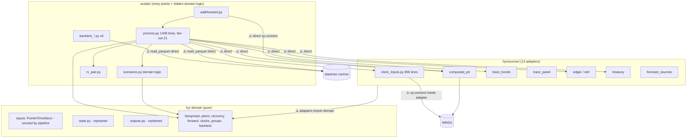

# Architecture Review Report

**Project:** FundamentalQuantmental (HY Analyst)
**Date:** 2026-10-23
**Files reviewed:** 57 Python modules (hy/ 19, hy/sources/ 13, scripts/ 25), 31 test files
**Overall health:** 🟠 Weak — the core is sound; data entry is the problem
**Scope:** how data enters `hy/` and `scripts/`. Goal: one data module that everything else works from.

## Codebase Summary

The HY Analyst finds mispriced high yield bonds. `hy/` holds the methodology layers (fair spread, recovery, forward cases, clocks, peers, groups, backtest maths) as pure functions. `hy/sources/` holds 13 adapters: WRDS Compustat, TRACE (two paths: per-issuer `trace_bonds` and monthly `trace_panel`), EDGAR and XBRL, Treasury curves, and forecast sources. `scripts/` holds the entry points: `process.py` (1,408 lines) runs the 15-step issuer process, `walkforward.py` replays it at past dates, and five `backtest_*.py` scripts run panel tests. Caches live in `data/raw/`. 432 tests, 71 commits, 18,844 lines of Python.

## Scorecard

| Dimension | Score | Key Finding |
|---|---|---|
| Boundary Quality | 🟠 | Domain logic lives in `scripts/`; `clock_inputs.py` mixes five jobs |
| Dependency Direction | 🟠 | `hy/` is clean, but 9 call sites open WRDS and 16 files hard-code `data/raw` |
| Abstraction Fitness | 🟠 | A typed point-in-time store exists; the pipeline passes untyped dicts instead |
| DRY & Knowledge | 🟠 | LTM, FCF, leverage, look-ahead guard, HY index each defined 2–5 times |
| Extensibility | 🔴 | Swapping the spread source touches 15 files and changes existing logic |
| Testability | 🟡 | Pure maths well tested; the pipeline is testable only against live caches |
| Parallelisation | 🟡 | Independent issuers and dates run one after another |

**Overall: 🟠 Weak — the domain core is pure and tested; data access has no single owner.**

## Dependency Graph (layer level)

## Detailed Findings

### AR-EXT-001: A data-source change is shotgun surgery
- **Finding ID:** AR-EXT-001
- **Dimension:** Extensibility
- **Severity:** 🔴
- **Location:** 15 files read `g_spread`: `hy/backtest.py`, `hy/peers.py`, `hy/rv.py`, `hy/sources/{treasury,trace_bonds,trace_panel,forecast_sources}.py`, `scripts/{process,scenarios,rv_pair}.py`, `scripts/backtest_{alpha,clocks,peers,peer_line,peer_report}.py`
- **Principle violated:** Open/Closed; Dependency Inversion
- **Evidence:** the spread field name and its TRACE meaning (G-spread, not OAS) are built into domain functions and scripts. TRACE enters through two adapters with different cleaning.
- **Impact:** an OAS vendor, a new index, or Bloomberg data means editing existing logic in 15+ places. The backtest write-up names OAS as a limit.
- **Recommendation:** define one bond-observation contract (fields, units, `available_at`) that every adapter fills. Domain code reads the contract, never a vendor field.

### AR-DEP-001: No single data entry point
- **Finding ID:** AR-DEP-001
- **Dimension:** Dependency Direction
- **Severity:** 🟠
- **Location:** `cp.connect()` at `hy/sources/clock_inputs.py:493,532`, `scripts/process.py:1270`, `scripts/walkforward.py:96,203,632`, `scripts/rv_pair.py:247`, `scripts/backtest_alpha.py:70`, `scripts/backtest_clocks.py:69`, `scripts/load_financials.py:31`. `RAW = ROOT/"data"/"raw"` in 16 files. `cache_root` threaded through 16 modules.
- **Principle violated:** Dependency Inversion; single source of configuration
- **Evidence:** every entry point builds its own connection, its own path root and its own cache reads (`process.py` has 6 `read_parquet` calls into `data/raw/backtest`).
- **Impact:** a run cannot be pointed at another data root, a frozen snapshot or a fake source without editing each file.
- **Recommendation:** one data-access module owns the connection, the cache root and the point-in-time view; entry points receive it as a parameter.

### AR-ABS-001: The typed point-in-time store exists, and the pipeline bypasses it
- **Finding ID:** AR-ABS-001
- **Dimension:** Abstraction Fitness
- **Severity:** 🟠
- **Location:** `hy/inputs.py` (`PointInTimeStore`, `IssuerFinancials`, `Tranche`), built by `hy/sources/financials.py`; unused by `scripts/process.py`, which passes `blk` dicts with 20 ad hoc keys (`_ltm`, `_quarters`, `_fcf_ltm`, `_ref`, `_sc_out`, …)
- **Principle violated:** make invalid states unrepresentable; boundary validation
- **Evidence:** the `inputs.py` docstring says "All downstream layers read through a view." The walk-forward crashed on `KeyError: 'ebitda_rep_q'` because `ltm_figures` returns a dict whose keys depend on the data (fixed in `a675525`).
- **Impact:** missing data surfaces as a crash deep in step 3, not at the boundary. The point-in-time guarantee depends on each caller remembering to filter.
- **Recommendation:** make the existing store and typed records the data module's output; a missing field becomes an explicit typed "missing" at load time.

### AR-BND-001: Domain logic lives in scripts
- **Finding ID:** AR-BND-001
- **Dimension:** Boundary Quality
- **Severity:** 🟠
- **Location:** `scripts/process.py` (steps 2–15, `ltm_figures`, `group_estimates`, `peer_table`), `scripts/scenarios.py` (imported by `process`, `rv_pair`, `walkforward`), `scripts/rv_pair.py`
- **Principle violated:** rate-of-change alignment; `CLAUDE.md` rule "code lives in `hy/`"
- **Evidence:** `walkforward.py` imports `process`; `process` imports `scenarios`, `rv_pair`, `memo`, `clock_case`. Tests reach in through `sys.path` (`tests/test_scenarios.py`, `tests/test_process.py`).
- **Impact:** the methodology's actual pipeline is not a package; it cannot be imported or reused cleanly, and it changes with report formatting.
- **Recommendation:** move the step functions and the scenario engine into `hy/`, one module per layer; scripts become thin entry points.

### AR-DRY-001: Core quantities defined several times
- **Finding ID:** AR-DRY-001
- **Dimension:** DRY & Knowledge
- **Severity:** 🟠
- **Location:** LTM: `scripts/process.py:232`, `hy/sources/clock_inputs.py:450`. FCF: `hy/state.py:142`, `hy/books.py:58`, `scripts/process.py:278,312`. Margin trend: `hy/state.py:98`, inline fit `scripts/process.py:308`. Leverage: panel `leverage_full`, step 5 `lev_gross`, `risk.lev_lease_adj`. HY index: `hy/backtest.benchmark_spread`, macro `s_index_now` (`scripts/scenarios.py`).
- **Principle violated:** single source of truth for a business rule
- **Evidence:** MGM's debt is $6.1bn in step 5 and $31.7bn in the panel; SPiDER flipped from +363 to −417 when the peer cells switched source.
- **Impact:** two parts of the system disagree on the same issuer without anyone noticing.
- **Recommendation:** one definition per quantity in one domain module; the data module supplies raw items, the domain computes each quantity once.

### AR-DRY-002: Five look-ahead guards
- **Finding ID:** AR-DRY-002
- **Dimension:** DRY & Knowledge
- **Severity:** 🟠
- **Location:** `LookAheadError` in `hy/inputs.py:16`, `hy/backtest.py:50`, `hy/walkforward.py:25`; guards `backtest.assert_no_lookahead`, `forecasts.assert_no_lookahead:162`, `walkforward.assert_pit:44`, `inputs.assert_point_in_time:146`; audit `scripts/walkforward.py:51`
- **Principle violated:** single source of truth
- **Impact:** the repo's most important rule has five implementations; a fix to one does not reach the others.
- **Recommendation:** one guard, one exception, enforced once at the data module's boundary.

### AR-BND-002: `clock_inputs.py` does five jobs
- **Finding ID:** AR-BND-002
- **Dimension:** Boundary Quality
- **Severity:** 🟡
- **Location:** `hy/sources/clock_inputs.py` (806 lines, fan-out 7): EDGAR text parsing (`parse_rpo`, `parse_lease_term`), XBRL lease extraction, WRDS loading (`run_loader`, `loader_quarters`), issuer lookup, overrides, `derive_inputs`
- **Principle violated:** Single Responsibility
- **Impact:** a change to the WRDS loader risks the text parsers and the reverse.
- **Recommendation:** split by source and by job, behind the data module.

### AR-DEP-002: Adapters import domain computation
- **Finding ID:** AR-DEP-002
- **Dimension:** Dependency Direction
- **Severity:** 🟡
- **Location:** `hy/sources/clock_facts.py → hy.backtest, hy.clocks`; `trace_panel.py → hy.rv`; `schedules.py → hy.clocks`
- **Principle violated:** Dependency Inversion (adapters should depend on record types only)
- **Evidence:** importing record types (`hy.inputs`) is correct; importing `hy.backtest` and `hy.rv` puts computation inside adapters.
- **Recommendation:** adapters depend only on the record types; computation moves to the domain.

### AR-TST-001: The pipeline is tested only by running it on live caches
- **Finding ID:** AR-TST-001
- **Dimension:** Testability
- **Severity:** 🟡
- **Location:** `scripts/process.run`, `scripts/walkforward.run_all`
- **Evidence:** three walk-forward bugs (the `None` guard, the mixed column, the missing step 5) surfaced only in full runs; no fake data source exists; the unit suite takes 22 s.
- **Recommendation:** with a data-module interface, add an in-memory fake source (2 issuers, 2 dates) and run `process` and `walkforward` against it in the suite.

### AR-PAR-001: Independent work runs sequentially
- **Finding ID:** AR-PAR-001
- **Dimension:** Parallelisation
- **Severity:** 🟡
- **Location:** issuer loop in `process.run` (~3 s per issuer); date loop in `walkforward.run_all` (9 dates × 35 s); month loop in `backtest.run_predictions`
- **Recommendation:** once data access is one read-only point-in-time module, issuers and dates become pure jobs that can run in parallel.

### AR-ABS-002: Output schemas are orphaned
- **Finding ID:** AR-ABS-002
- **Dimension:** Abstraction Fitness
- **Severity:** 🟡
- **Location:** `hy/outputs.py`, `data/schemas/*.json` (used only by `tests/test_outputs.py`); `scripts/process.py:1373` writes ad hoc JSON
- **Recommendation:** the pipeline writes through `outputs` so the schema is enforced.

## Positive Highlights

1. **The domain core is pure.** No module in `hy/` imports `hy/sources` or `scripts/`, and the import graph has no cycles.
2. **Point-in-time is a first-class idea.** Every cache row carries `available_at`, and the right abstraction (`PointInTimeStore`) already exists.
3. **Pure functions with hand-checked tests.** 432 tests check signs, hand calculations and look-ahead fixtures.
4. **Decision pages and research cards** trace every choice, which makes a refactor auditable.

## Recommended Review Cadence

Re-run after the data module lands, and before adding any second vendor (OAS, Bloomberg, ICE).

## Handoff

| Dimension | Score | Key Finding |
|---|---|---|
| Boundary Quality | 🟠 | Domain logic in `scripts/`; `clock_inputs.py` mixes five jobs |
| Dependency Direction | 🟠 | 9 WRDS connection sites, 16 hard-coded data roots, no data entry point |
| Abstraction Fitness | 🟠 | `PointInTimeStore` exists but the pipeline passes untyped dicts |
| DRY & Knowledge | 🟠 | LTM, FCF, leverage, HY index and look-ahead guard defined 2–5 times |
| Extensibility | 🔴 | Swapping the spread source touches 15 files |
| Testability | 🟡 | No fake source; pipeline bugs surface only in full runs |
| Parallelisation | 🟡 | Independent issuers and dates run one after another |

| Finding ID | Severity | Dimension | Location | Summary |
|---|---|---|---|---|
| AR-EXT-001 | 🔴 | Extensibility | `g_spread` in 15 files; `trace_bonds` + `trace_panel` | Vendor fields leak into domain code and TRACE enters by two paths; a new spread source means editing 15+ files. |
| AR-DEP-001 | 🟠 | Dependencies | `cp.connect` ×9; `RAW` ×16; `cache_root` ×16 | Each entry point builds its own connection, data root and cache reads; no single data module. |
| AR-ABS-001 | 🟠 | Abstraction | `hy/inputs.py`; `scripts/process.py` `blk` dicts | The typed point-in-time store exists but is bypassed; untyped dicts caused the `KeyError` crash. |
| AR-BND-001 | 🟠 | Boundaries | `scripts/process.py`, `scripts/scenarios.py`, `scripts/rv_pair.py` | The pipeline and scenario engine live in scripts and are imported through `sys.path`. |
| AR-DRY-001 | 🟠 | DRY | `process.py:232,278,308,312`; `state.py`; `books.py`; `clock_inputs.py:450` | LTM, FCF, margin trend, leverage and HY index have several definitions; MGM's debt differs 5-fold. |
| AR-DRY-002 | 🟠 | DRY | `inputs.py:16`, `backtest.py:50`, `walkforward.py:25`, `forecasts.py:162` | Five look-ahead guards and three `LookAheadError` classes. |
| AR-BND-002 | 🟡 | Boundaries | `hy/sources/clock_inputs.py` | 806 lines mixing EDGAR parsing, XBRL, WRDS loader, lookup and overrides. |
| AR-DEP-002 | 🟡 | Dependencies | `clock_facts`, `trace_panel`, `schedules` | Adapters import domain computation (`backtest`, `rv`, `clocks`). |
| AR-TST-001 | 🟡 | Testability | `process.run`, `walkforward.run_all` | No fake data source; pipeline bugs surface only in full runs. |
| AR-PAR-001 | 🟡 | Parallelisation | `process.run`, `walkforward.run_all`, `backtest.run_predictions` | Independent issuers and dates run sequentially. |
| AR-ABS-002 | 🟡 | Abstraction | `hy/outputs.py`, `data/schemas/` | Output schemas enforced only in tests; the pipeline writes ad hoc JSON. |
